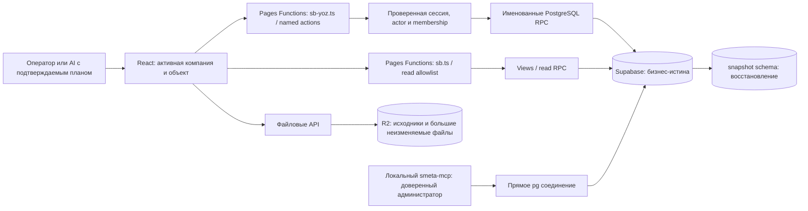

# Текущая карта системы — индекс для совместной работы

generated_at: 2026-10-26T05:48:29Z  
git_commit: 69db8d45050cc82dfd67baae6dec7153b727a219  
db_migration_head: 20261106510000 / t2_agent_qidiruv_v1

Документ — производная карта наблюдённого состояния, не новый продуктовый контракт. Задание Claude L026.10: architecture pack без runtime/DDL. HEAD истории миграций — лексикографический max(version), не время последнего DDL. Последующие PR и deployment проверяются отдельно. Основа законов: CONSTITUTION, существующие F2_IMPORT_V3, SMETA_F2_NAKOPITELNIY_CHANGE_CONTROL_V1, FILE_TRUTH_AND_SECONDARY_REPLICA_V1 и ekotizim/E3. Каноническая очередь и назначения — Obsidian PRODUCT_ROADMAP / KOORDINATSIYA.

## Как проходит действие

Web gateway и локальный MCP — разные trust boundaries. Web actor берётся из проверенной сессии; MCP использует выбранный actor и привилегированное соединение, минуя web allowlist. Его наличие не означает, что произвольный SQL разрешён веб-пользователю. MCP-QA01: текущий dry_run у sql_yozish допускает COMMIT в тексте; до исправления обещание отсутствия записи не доказано.

## Четыре отдельные истины PTO

1. Исходная смета/редакция — документ и неизменяемая база сравнения. t2_qator — текущая структурная проекция; утверждённые изменения имеют отдельные записи t2_smeta_revision / t2_smeta_ozgarish. Нельзя молча переписать исходник ради совпадения с фактом.
2. Физический факт — измеренное исполнение, независимо от экспертизы и оплаты. Срезанная экспертизой, но построенная работа не исчезает: требуется решение/да'во. Занятый lane: claude/smeta-versiya-farq, новый параллельный model не создаётся.
3. F2 — предъявление и утверждение. Только допустимые состояния акта питают накопительную/F3; фактическое выполнение само по себе не является утверждённым F2. Режим формирования F2 может опираться на смету без обязательного факта по решению владельца.
4. Договор, оплата, затраты и склад — самостоятельные журналы. F3, оплачено и физически выполнено нельзя считать синонимами.

## Что точно инвентаризировано

SELECT каталога: public199 и snapshot5, всего204 application tables; все имеют RLS flag. Это не проверка policies/grants или tenant isolation. Public routines572; snapshot routines не включены в эту цифру. Исключены управляемые auth/storage/realtime/cron/vault и migration history. Бизнес-строки, пароли, ключи, файлы смет в pack не входят.

[DATA_MODEL_REGISTRY.yaml](DATA_MODEL_REGISTRY.yaml) — по одному отношению, модуль, lifecycle-класс, FK, triggers и кандидаты write paths. YAML представлен JSON-подмножеством YAML1.2. Класс CANONICAL означает наблюдённое активное хранилище модуля; не превращает каждую таблицу в финансовую истину. Неразрешённые классы NULL, не DEPRECATED. [ROUTINE_TABLE_REFERENCES_20261026.json](ROUTINE_TABLE_REFERENCES_20261026.json) — текстовые ссылки из live bodies, не доказательство вызова/записи. SQL в комментариях и dynamic SQL требуют ручного review.

[ROUTE_RPC_MAP.md](ROUTE_RPC_MAP.md) — статический инвентарь существующего site-map, а не новый runtime реестр. [DOMAIN_MAP.md](DOMAIN_MAP.md), [PTO_STATE_MACHINE.md](PTO_STATE_MACHINE.md), [GOLDEN_FLOWS.md](GOLDEN_FLOWS.md) объясняют границы и приёмку. [RISK_REGISTER.md](RISK_REGISTER.md) хранит только привязанные к этому capture проверки/пробелы.

## Воспроизведение

`node docs/architecture/generate-architecture-pack.mjs` — offline: immutable git archive указанного pin + сохранённый SELECT capture. Нужны Node, Git и tar; база/секреты не нужны. Генерируются registry и ROUTE_RPC_MAP. Для нового capture обновить metadata и pin после review, не подставлять текущий main автоматически. Полученный hash/количества сверить с snapshot. Live metadata и Git history могут расходиться: присутствие SQL-файла не означает apply.

## Ответственность и следующий шаг

Claude L0 интегрирует/deploy и назначает runtime fixes. Codex владеет этим documentation pack и независимыми probes. Существующие Fakt, Sidebar и revision branches сохраняют владельцев. Перед изменением: найти эквивалент в CODEMAP; выбрать named command; задать tenant/actor/version/operation_id; указать, какая из четырёх истин меняется; затем провести golden flow. Схема snapshot не заменяет проверенный restore drill и не делает destructiveness безопасной по умолчанию.
