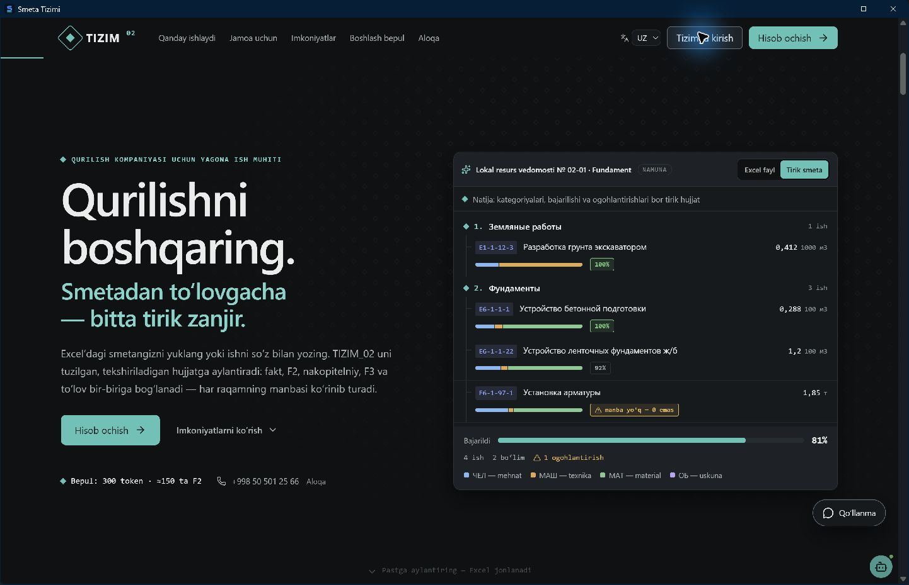

# Desktop M5 — протокол приёмки Windows

Статус: сквозная приёмка не выполнена. Основа PR — main 9a6d4ec1. Показанное ниже установленное приложение — предыдущая оболочка, не сборка M1–M4.

## Фактически проверено

Computer Use запустил существующий C:/Temp/SmetaDesktopSmoke/smeta-desktop.exe и получил окно «Smeta Tizimi», WebView http://tauri.localhost/. Начальный экран PublicEntry отрисован. Пароли не вводились; подтверждённого входа и объекта нет. Новый снимок заменяет прежнюю неудачную попытку list_windows.

Краткий [лог smoke](DESKTOP_E2E_assets/native-smoke-20261104.txt). Скриншот содержит публичный демонстрационный экран, не данные компании.

M1 отдельно создал новый локальный installer: C:/Temp/Smeta-M1-new-1104/Smeta Tizimi_0.1.0_x64-setup.exe, 7632695 байт, SHA-256 9b8379e389f7119857644b380034bb684ec3fa15e25ad249db50fed453224f2f, NotSigned. Манифест и R2 dry-run проверены; этот EXE здесь не устанавливался. Он собран до переноса M1 на новый main. Прежний установленный EXE нельзя выдавать за новый выпуск.

M4: 11 синтетических тестов пакета/хранилища прошли, включая 200 → AES-GCM → подтверждённый 304 → повторное чтение и очистку. Это не реальный native offline E2E.

## Незавершённая приёмка после интеграции L0

1. Пересобрать exact принятый SHA, сверить манифест и EXE, установить и зафиксировать версию. Текущий smoke этого не доказывает.
2. В Preview/тестовой компании войти штатным способом, открыть разрешённый объект; записать обезличенные 200/ETag. Запрещённый объект должен дать 403 без чтения кэша.
3. Без сети проверить смету, факт, F2, остатки, NULL и собственный подвал по действующему подписанному lease. Команды записи недоступны. Пока lease не реализован, отказ при потере сети — ожидаемое поведение, не готовый offline режим.
4. Подключиться: 304 для неизменного пакета, 200 для нового. Выход, истечение lease и серверный отзыв закрывают доступ к старому снимку.
5. Приложить обезличенные скриншоты/лог каждого шага и точный SHA. Токены, пароли, INN и реальные суммы не публиковать.

Блокеры: desktop Bearer несовместим с BFF Cookie; нет подписанного server lease, законченного bootstrap и авторизованного тестового объекта. Production, сеть ноутбука и чужие процессы не изменялись. Полная M5 остаётся открытой.
