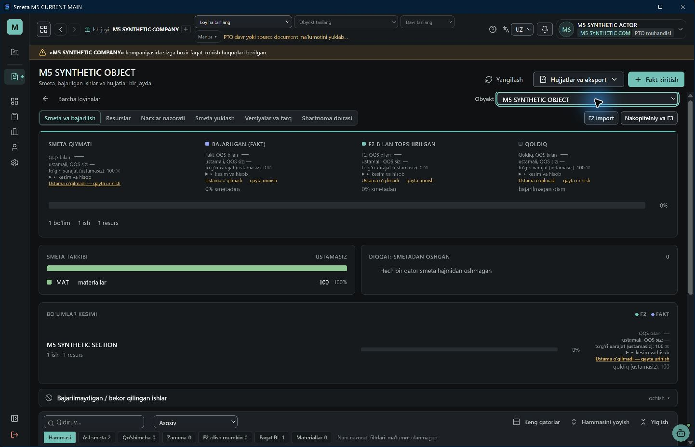
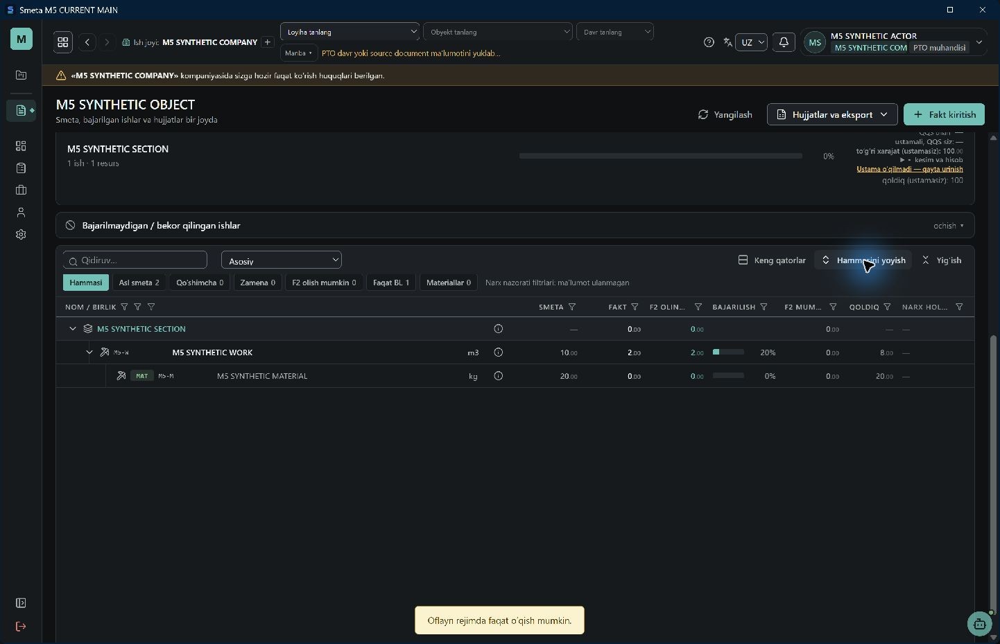
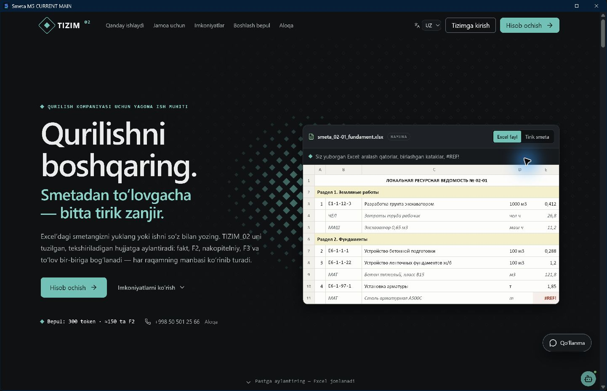

# Desktop M5 — текущая native-приёмка Windows

Статус 09.11.2026 — **нативная выгрузка ЛРВ после восстановления связи проверена на синтетическом стенде**. Холодный запуск без связи подтверждён отдельными прогонами.

## 09.11.2026. Выгрузка ЛРВ после восстановления связи

Сборка `de14d6177629dd1a6a15d4ec2d09073da9ec4a23` на базе `85ce90d32f3a5262e3e09ed53f8aa778750330ba`. Установлен NSIS x64 SHA-256 `C3F89FF3DDD4000C07A11B2A921C5612FB1D275D46F84EEEE9DA1926481B6A80`. Authstub и PGlite на `127.0.0.1:5223`.

1. В установленном приложении открыт объект 101 через проект и договор. После TCP abort ЛРВ осталась доступна для чтения, три кнопки выгрузки заблокированы. Число вызовов списания не изменилось.
2. После `online` и «Yangilash» счётчик HTTP 304 увеличился с 1 до 2, офлайн-баннер исчез, кнопка «LRV Excel» стала доступна. Нажатие создало файл, вызвало одно списание и одно завершение операции.
3. Проверка OOXML выгруженного файла прошла. На листе `LRV` 93 формулы, прямые расходы 100,00, итог с НДС 141,86. Архивная позиция и имя исходной версии находятся на листе `Пред. версия`. SHA-256 файла `2ea7a231c4a9d6dfa534b5fa74c11aae1b469ae4135440c33c5598c6878a73f6`.

13 групп HTTP smoke, 118 целевых Vitest, TypeScript приложения и Functions, lint изменённых файлов прошли. Полная загрузка всех отчётов, восстановление иерархии PTO после холодного офлайн-старта, запись Факта через окно, публичная публикация и приёмка на рабочем сервере остаются открытыми.

## 06.11.2026. Cold offline и восстановление связи

Сборка `e16f2820518c26f767514a0966b9b3c3f91ad038` основана на `2ed66b869493f258cf508685c03e05e985061d07` после merge #278 и #279. Исправление в ней соответствует PR #286 (`75a72749`). [Манифест установленной сборки](DESKTOP_E2E_assets/native-ipc-fixed-install-20261106.json).

1. На сборке без #286 после входа зависало чтение дерева объекта 101. Tauri IPC вызывает глобальный fetch, а обёртка ошибочно запускала повторный IPC из сохранения маршрута. На сборке с #286 дерево и состояние загрузились по штатному пути Smeta/Fakt.
2. Переключил только локальный стенд в режим TCP abort, закрыл приложение и запустил снова. Восстановился маршрут `/admin/holat/101`, на экране появился раздел сметы и режим чтения. Счётчики чтений дерева и состояния на сервере остались 5/5. Число оборванных запросов выросло с 2 до 24.
3. Перевёл стенд online и нажал «Yangilash». Счётчик HTTP 304 вырос с 1 до 2, чтения дерева и состояния выросли до 9/9. Исходный 304 относится к HTTP smoke, приращение относится к Windows-приложению. Объект остался открыт.
4. Офлайн меню документов показало блокировку Excel из-за недоступных признаков дополнений/замен. Подсказка PTO об офлайн-источнике сохранилась после reconnect. Проверка отсутствующих финансовых полей и F2 footer выполнена в синтетическом HTTP smoke. Полная проверка экспорта, общего флага serverTasdiq и операций записи в UI остаётся открытой.

[Этапы и счётчики](DESKTOP_E2E_assets/native-ipc-fixed-stats-20261106.json) · [Выписки из интерфейса](DESKTOP_E2E_assets/native-ipc-fixed-ax-20261106.txt).

## Исторический прогон 05.11.2026

Base main `0027062d4fde6a81b54c91208eae3e8336ef24b4`, source `59ec8f49c8ca3026223a63afb3c6709768d0c42a`. В этой сборке cold offline restart остался на PublicEntry.

## Стенд и границы

Новый NSIS, identifier `uz.anncorp.smeta.e2e`, отдельный keychain service, feature desktop-e2e, loopback127.0.0.1:5216. Реальные Desktop issue/lease/gateway, middleware, session/company/sb/packet handlers и миграция20261202000000; PGlite и бизнес-данные синтетические. Пароль — **authstub**, не production login. Исходящий HTTP стенда запрещён; сеть ноутбука не отключалась. Private keys/cookies/Bearer не сохранялись. Production/main/R2/DB не изменялись.

Installer SHA256 `14B8FA6ACAA89783D8DA25C0A26A43F87713B5BDAA7ADEA9DBB8FB9E9D3C200F`; installed EXE SHA256 `94440E3E84EAEBC014102E37E3D6DB6D78328E3AFCC91E9388342DE7C835E6F7`, NotSigned. Silent install exit0, фактический каталог C:/Users/anvar/AppData/Local/Smeta M5 CURRENT MAIN. [Манифест установки](DESKTOP_E2E_assets/native-current-install-20261105.json).

## Проверено Computer Use в установленном приложении

1. Fixture login через штатную форму; компания и роль PTO отображаются. Первоначальный fixture без `context_kompaniyalar.faol` исправлен и защищён assertion. Это не дефект production company context.
2. Через sidebar открыт `/admin/holat`, обычным списком выбран M5 SYNTHETIC OBJECT(101). Загружена существующая страница «Smeta va bajarilish», не отдельное offline-приложение.
3. Online прочитаны реальные `/sb` projections t2_daraxt/t2_qator_holat; пакет/lease получены native transport. Дополнительные отсутствующие источники показывают ошибки, а не успешные заглушки.
4. Control abort закрыл TCP только loopback-стенда. На той же странице нажато Yangilash: данные остались доступны, появился баннер «Oflayn rejimda faqat oʻqish mumkin».
5. Офлайн Hammasini yoyish раскрыл section/work/material: исходные объёмы10/20, факт2, F2объём2. Это чтение строк, не подтверждение всех финансовых итогов или UI-запрета каждой кнопки записи.
6. Приложение закрыто и открыто при TCP abort: PublicEntry `/`, сохранённый объект штатным потоком не восстановлен. Cold offline acceptance НЕ пройдена; потеря keychain/token этим не доказана.
7. Стенд возвращён online. Reconnect/304 проверены HTTP smoke; native восстановление того же объекта после cold restart не подтверждено.

## Проверки исходников и HTTP

На текущем main baseline app/functions TypeScript, scoped lint,106focused PASS. Desktop Vite/Rust release/NSIS build PASS (после смены signing pair пересобрано). Rust/runtime код M5 не менялся; прежние23native теста не выдаются за повторный текущий прогон.

После исправления active-company fixture HTTP smoke PASS: issue/check/revoke; company; decoder-backed tree/holat; NULL price/F2 и footer в пакете; tenant/permission403;304; Ed25519/tamper; migration quota30/31→429;503; TCP abort/recovery; DELETE self-revoke→401. Это синтетические серверные проверки, не native UI acceptance всех состояний.

[Статистика после native-прогона](DESKTOP_E2E_assets/native-current-stats-20261105.json) содержит unimplementedDb>0: shared PTO запрашивает дополнительные RPC/таблицы, ещё отсутствующие в fixture. Нулевые счётчики раннего HTTP smoke не переносятся на native-прогон. adapterErrors пуст, но это не означает полного покрытия.

Root governance FAIL: прежний TRANSPORT missing base_sha и C11/TENDER/TRANSPORT/STUDIO ownership overlaps. Чужие locks не исправлялись.

## Открытые задачи L0

- **Cold bootstrap/route:** WebView стартует `/`; App.tsx направляет в KirishSahifa, desktop entry импортирует main без восстановления разрешённого маршрута. Нужен согласованный переход в существующую страницу после проверки native session/lease; без нового интерфейса и обхода expiry/revoke.
- **Home:** `/api/ish-joyi?bolim=joylarim` отсутствует в native PATH и BFF dispatch; HTTP smoke фиксирует TARGET_INVALID400. PTO с активной компанией стартует в /admin/obyektlar, но личный home остаётся отдельной интеграцией.
- **Fixture coverage:** ProjectNavigator требует shartnoma_liniya_v1, PTO periods/source/markup — дополнительные источники. Их отсутствие в стенде не доказывает production DB дефект. Расширить синтетический DB adapter без подмены реальных handlers успешными ответами.
- **Shared semantics:** NULL финансовые итоги, serverTasdiq/export, offline-кнопки записи и F2/footer native UI ещё требуют приёмки. Ввод/редактирование через видимые кнопки не выполнялись.
- После согласованного bootstrap повторить cold start→тот же объект→TCP abort→native reconnect304, затем logout/expiry/revoke. Live owner acceptance и release signing отдельно у L0.

Скриншоты20261104 в assets исторические; в текущем результате не используются. M5 не завершён, PR остаётся draft. Main/prod и shared UI не менялись.

## 09.11.2026 — запись Факт и холодное чтение на Windows

- Сборка `cfa4f7c2` (Vite, Rust, NSIS), установка с кодом 0. Стенд 5224, authstub и PGlite. Вызваны штатный BFF и SQL `t2_fakt_yoz_v2`/`t2_akt_yarat`. Нижний `t2_fakt_yoz` реализован синтетическим адаптером. Его production-реализация и пересчёт дочерних норм в этом прогоне не проверены.
- В Windows в журнале введена одна единица и нажато Ctrl+S. Факт изменился с 3 на 4, утверждённый объём Ф2 остался 2. Счётчик `t2_fakt_yoz_v2` вырос с 3 до 4, счётчик чтения пакета с 3 до 4 уже на странице Факт. HTTP smoke отдельно проверил повтор операции, запрет чужого объекта и ручной записи в RS, смену ETag и сохранение NULL в сумме утверждённой Ф2.
- После TCP abort и полного перезапуска открылась `/admin/holat/101`. В строке смета 10, Факт 4, Ф2 2, доступно для Ф2 2, остаток 8. Счётчик записей остался 4. В офлайн-карточке Факт показано 0. В стенде денежный Факт оставлен NULL, поэтому приёмка финансовой сводки этим прогоном не подтверждена.
- После возврата сети и подтверждённого клика «Yangilash» HTTP 304 увеличился с 2 до 5, строка сохранилась. Нижний индикатор desktop исчез; в шапке остались старое сообщение PTO и незаполненный селектор. Полное восстановление рабочего контекста не принято. У стенда 21 обращение к нереализованным вспомогательным источникам, 0 ошибок адаптера и 0 исключений handler. Снимки `C:/Temp/desktop-1109-fakt-native-{after,offline,reconnect}.json`.
- App/Functions TypeScript, 112 focused Vitest, lint, npm run tekshir и diff-check PASS. Governance FAIL на существующих межзадачных locks и отсутствующем TRANSPORT base_sha. Установщик для локального стенда. Production и публичный релиз отдельно.

## 09.11.2026 — выход на Windows и обновление стенда

- В установленной Windows-сборке `cfa4f7c2` на стенде 5224 выполнен «Tizimdan chiqish». Открылась `/`, счётчики отозванных устройств и RPC отзыва увеличились с 1 до 2. После TCP abort и полного перезапуска снова открылась `/`; объект 101 не восстановлен, счётчик муфты пакета остался 8. Снимки `C:/Temp/desktop-1109-fakt-native-logout.json` и `C:/Temp/desktop-1109-fakt-native-after-logout-restart.json`.
- Изменения Windows перенесены на `6026b774` (#315). До сборки нового установщика пройдено 14 групп HTTP smoke на свежем стенде 5226. Отдельно подтверждено, что файл публичной конфигурации от другого порта отклоняется до создания устройства. Публичный файл и кэш Vite по умолчанию разделены по порту.
