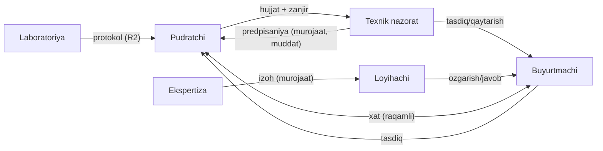
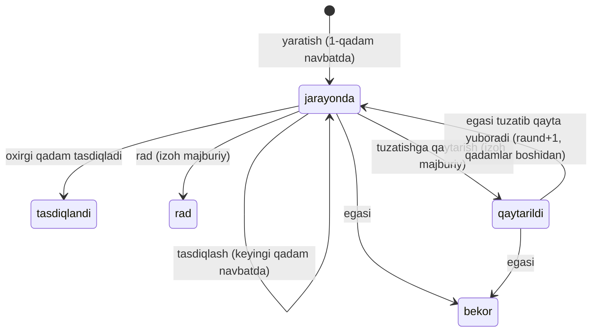

# Hujjat aylanishi (qog'ozbozlik end-to-end) va logistika — dizayn v1

Holat: MVP v1 (A qismi) qurilgan · 2026-11-04 · Egasi so'rovi: laboratoriya aktlari, shablonlar, tomonlar bog'lanishi.
Logistika (B qismi) — **boshqa sessiya** qurgan (PR #235, branch `claude/logistika-v1`: park, reys, tannarx, narxlash, rentabellik). Bu hujjat B uchun faqat shu havolani beradi; B kodi va jadvallari bu branchda YO'Q.

## 1. Mavjud nima bor (so'rovdan oldingi tadqiqot)

| Qatlam | Bor | Bo'shliq |
|---|---|---|
| Tomonlar | `t2_tomon_aloqa` (handshake), `t2_tomon_grant` (ko'rish ruxsati), `t2_tomon_taqdim` (resurs taqdimi), `t2_tomon_hodisa` (o'zgarmas jurnal), E1 tomon modeli (`t2_yonalish`: laboratoriya, texnadzor, buyurtmachi, loyihachi, ekspertiza, pudratchi) | tomonlar orasida **tartibli tasdiq** va **xat** yo'q |
| Murojaat | `t2_tomon_murojaat` (+`_turi`, `_hujjat`): remark, **predpisaniya**, ekspertiza izohi, RFI, sinov so'rovi; muddat, raund, dalil (R2), yopish/qayta ochish | `talabnoma`/`ogohlantirish` turi yo'q; muddat **eslatmasi** yo'q |
| Ijro | `t2_aosr`, `t2_aosr_bog`, `t2_lab_protokol`, `t2_lab_protokol_bog` (laboratoriya = alohida kompaniya/kontragent), `aosr-export.ts` (ШНК 3.01.01-22 Прил. 6) | laboratoriya protokoli, osvidetelstvovaniya akti, predpisaniya, soprovod xat **shablonlari** yo'q |
| Bildirishnoma | `t2_outbox` (yagona hodisa shinasi) → `t2_outbox_ishlov_v1` → `t2_bildirishnoma` (qabul qiluvchi: boss/admin/rahbar/director/pto) | hujjat hodisalari yozilmaydi; UI yo'q |
| Fayllar | `t2_document_registry` + R2 (`/api/hujjat-ol`; tomon taqdimi/murojaat dalili uchun alohida yo'l) | zanjir qatnashchisi/xat qabul qiluvchisi faylni ocha olmaydi |
| Imzo | `t2_obyekt_imzochi`, `t2_imzochi_tarix`, `t2_yakunlash_talab` | tasdiq tartibi (kim kimdan keyin) yo'q |
| Ruxsat | `quality.read/inspect/decide`, `document.*`, rollar (`inspektor`, `pto`, `buyurtmachi` …) | — |
| Kutubxonalar | `construction-document-control` (Nakop., F-2, F-3 yopish), `hujjat-yozuvchi` (rasmiy .xlsx quruvchi, H1–H9) | — |

**Qaror: yangi «party» yoki «hujjat» tizimi yaratilmaydi.** Mavjud primitivlar (aloqa, murojaat, outbox, R2 reyestr) ustiga ingichka qatlam qo'shiladi: umumiy tasdiq zanjiri + xat reestri + kiruvchi quti + eslatma. Predpisaniya/talabnoma murojaat primitivida qoladi (dublikat yo'q).

## 2. Tomonlar xaritasi

Har juftlik faqat **faol aloqa** (`t2_tomon_aloqa.holat='faol'`) bo'lganda ishlaydi — bu tenant izolyatsiyasining yagona eshigi.

## 3. Ma'lumot modeli (migratsiya `20261122100000_t2_hujjat_aylanish_v1`)

Faqat 5 jadval, matn/raqam, **fayl yo'q** (Supabase 421/500 MB — fayllar `t2_document_registry.id` → R2).

| Jadval | Vazifa |
|---|---|
| `t2_hujjat_zanjir` | tasdiq zanjiri: egasi kompaniya, `hujjat_turi` (erkin kalit: aosr, lab_protokol, …), ixtiyoriy `manba_jadval/manba_id` va `document_id`, holat, raund |
| `t2_hujjat_zanjir_qadam` | 1–8 qadam: tartib, rol, tasdiqlovchi kompaniya, holat, muddat, izoh |
| `t2_hujjat_zanjir_tarix` | **o'zgarmas** jurnal (trigger): yuborildi/tasdiqlandi/rad/qaytarildi/qayta_yuborildi/bekor + izoh |
| `t2_xat` | xat: chiquvchi raqam (egasi) + kiruvchi raqam (qabul qiluvchi), tur, javob muddati, ota xat, ilova `document_id` |
| `t2_xat_raqam` | hisoblagich (kompaniya, yil, yo'nalish) — `CHIQ-2026-0001`, `KIR-2026-0001`; qator qulflanadi |

Qo'shimcha: `t2_tomon_murojaat_turi` ga `talabnoma`, `ogohlantirish`.

### 3.1 Tasdiq zanjiri holat mashinasi (umumiy, har qanday hujjat turi uchun)

Qoidalar (bazada, `security definer`, birinchi qatorda a'zolik/rol tekshiruvi):
- qaror faqat **navbatdagi** qadam kompaniyasining a'zosidan, roli `superadmin/admin/boss/rahbar/director/pto/buyurtmachi/inspektor`;
- qadam kompaniyasi o'zimiz yoki **faol aloqadagi** kompaniya bo'lishi shart (aks holda `ALOQA_YOQ`);
- hujjat (`document_id`) faqat egasining, `canonical_storage_status='stored'`;
- idempotent `operation_id`; hodisa `t2_outbox` ga (`hujjat.tasdiq_kutmoqda|tasdiqlandi|rad_etildi|qaytarildi`) — tasdiqlovchiga/egasiga bildirishnoma.
- Frontda aynan shu mashina `lib/hujjat-aylanish/zanjir.ts` (tugmalar uchun; haqiqiy ruxsat bazada) va testlangan.

Standart zanjirlar (`STANDART_ZANJIRLAR`): АОСР — texnadzor → buyurtmachi; laboratoriya protokoli — texnadzor; loyiha o'zgarishi — loyihachi → buyurtmachi; ekspertiza javobi — loyihachi → ekspertiza.

### 3.2 Xat reestri
- Chiquvchi xat faqat faol aloqadagi kompaniyaga; raqam ketma-ket, takrorlanmaydi (unikal indeks + qulflangan hisoblagich).
- Qabul qiluvchi **«qabul qilish»** bilan o'z kiruvchi raqamini oladi (holat `olindi`); javob xati (`ota_xat_id`) ota xatni `javob_berildi` qiladi.
- Turlar: xat, soprovod, **talabnoma**, **ogohlantirish**, javob xati, boshqa. `javob_muddati` — eslatma manbai.

### 3.3 Predpisaniya / talabnoma + eslatma
- Predpisaniya — mavjud murojaat primitivi (`turi='predpisaniya'`, muddat, raund, dalil). `talabnoma`/`ogohlantirish` — xuddi shu katalogga yangi tur.
- `t2_hujjat_eslatma_v1(p_kun_oldin)` (service_role, kuniga bir marta): muddatga `p_kun_oldin` kun qolgan yoki o'tgan **xat, murojaat va zanjir qadami** uchun `t2_outbox` ga `hujjat.muddat_yaqin|muddat_otdi` yozadi; `operation_id=md5(kalit:mavzu:sana)` — kuniga bitta. Mavjud `t2_outbox_ishlov_v1` ularni `t2_bildirishnoma` ga aylantiradi. O'tgan muddatda ikkala tomon xabardor bo'ladi.
- **Keyingi qadam (ulanmagan):** Cloudflare Cron'dan kuniga bir `t2_hujjat_eslatma_v1` chaqirish (outbox kroni qanday ulangan bo'lsa shunday). Migratsiya qo'llangach.

### 3.4 Kiruvchi quti
`t2_hujjat_kiruvchi_v1`: menga tegishli (a) navbatdagi tasdiq qadamlari, (b) hali javobsiz kiruvchi xatlar, (c) ochiq murojaat/predpisaniyalar; har birida muddati o'tgan belgisi. UI: `/admin/hujjat-aylanish` (tablar: Kiruvchi · Tasdiq zanjirlari · Xatlar reestri · Shablonlar).

### 3.5 Fayl kirishi
`/api/hujjat-ol` rad etgan holda `t2_hujjat_aylanish_hujjat_ol_v1` ni sinaydi: faqat shu aniq hujjat, faqat zanjir qatnashchisi yoki xat qabul qiluvchisi (bekor qilingan zanjir emas).

## 4. Shablonlar (`lib/hujjat-aylanish/shablon.ts`, markaziy `hujjat-yozuvchi` uslubida)

| Shablon | Asos | Imzo |
|---|---|---|
| Laboratoriya sinov protokoli | ШНК 3.01.01-22, sinov NHD; ko'rsatkich/talab/natija/xulosa jadvali | СОСТАВИЛ, ПРОВЕРИЛ |
| Osvidetelstvovaniya akti | ishlar, materiallar, chetlanishlar, natijalar, komissiya qarori | ЗАКАЗЧИК, ТЕХНАДЗОР, ПОДРЯДЧИК |
| Texnik nazorat predpisaniyasi | nuqson, joy, muddat, norma bandi, bartaraf etilganlik belgisi | ТЕХНАДЗОР, ПОДРЯДЧИК |
| Soprovod xat | kimga/mavzu/ilovalar ro'yxati | СОСТАВИЛ |

(АОСР — `aosr-export.ts` da mavjud.) Qoidalar: rasmiy matn RUS tilida; qiymat yo'q bo'lsa to'ldirish chizig'i (o'ylab topilmaydi); barcha qatorlar ramkali, rangsiz, A4 bir sahifa eniga; yetishmagan majburiy maydonlar `ПОЗИЦИИ, ТРЕБУЮЩИЕ ВНИМАНИЯ` sifatida hujjatda ko'rinadi (`toliqlik.ts`, sof funksiya). Dizayn tizimi (tip belgisi yashirin, BL qalin, RS kursiv, ierarxiya darajalari) `hujjat-yozuvchi` ichida markaziy; shablonlar o'zi uslub yozmaydi — `RasmiyVaraq` orqali meros oladi.

Keyingi shablonlar (ro'yxat, kod yo'q): исполнительная схема, журнал работ (ОЖР), акт приёмки, акт входного контроля, акт испытаний систем, предписание ГАСН, протокол совещания.

## 5. Xavfsizlik
- Barcha RPC `security definer`, `search_path` qat'iy, `revoke all … from public, anon, authenticated; grant … to service_role`.
- Shlyuz `/api/hujjat-aylanish`: ro'yxatdagi RPC lar (ixtiyoriy nom yo'q), actor sessiyadan, qiymatlar tozalanadi; `permission-policy` da `SCOPED_APIS` ga kiritilgan (o'qish va qaror/qabul — `document.read`, qolgan yozish — `document.write`; rol bazada).
- Audit: `t2_audit_yoz(kompaniya, amal, tur, obyekt_id|null, tafsilot, kim, null)`.
- GitHub'ga real nom/summa/INN yozilmaydi; testlar sintetik.

## 6. AI yordam (keyingi bosqich; hozir qoida asosida)
- **Qurilgan:** to'liqlik tekshiruvi — deterministik (`shablonToliqligi`), AI'siz.
- **Keyingi:** `aiHisobli` qoidasi bo'yicha (token yechadi, qayta yuklash takror yechmaydi): (1) kontekstdan xat/akt qoralamasi (obyekt, ishlar, laboratoriya natijalari → matn), (2) tekshiruv natijasini ma'no bo'yicha to'ldirish. AI natijasi faqat **qoralama** — foydalanuvchi tasdiqlamaguncha zanjirga kirmaydi.

## 7. Logistika (B) — #235
Park, reys, tannarx, narxlash va rentabellik PR #235 (`claude/logistika-v1`) da. Bu branchda logistika kodi/jadvali yo'q; keyingi integratsiya nuqtalari: (1) reys hujjatlari (yo'l varag'i, yuk xati) shu hujjat aylanishi zanjiriga `hujjat_turi='yol_varagi'` bilan kiritilishi mumkin; (2) yetkazish talabi — mavjud `yetkazish_talabi` murojaat turi.

## 8. Qo'llash tartibi va keyingi qadamlar
1. Migratsiya `20261122100000_t2_hujjat_aylanish_v1.sql` (oldin prod'da acceptance'ni **branch**'da `BEGIN..ROLLBACK` bilan yurgizing; keyin prod, keyin merge). Boshqa migratsiyaga bog'liq emas (`t2_tomon_*`, `t2_outbox`, `t2_document_registry` allaqachon bor).
2. Cron: kuniga bir `t2_hujjat_eslatma_v1(2)`.
3. Bildirishnoma UI (qo'ng'iroqcha): RPC va BFF bo'limi (`bolim=bildirishnomalar`) tayyor, i18n kalitlari qo'shilgan; ko'rsatish komponenti keyingi ish.
4. АОСР/lab protokoli reestrlaridan «tasdiqqa yuborish» tugmasi (`manba_jadval/manba_id` allaqachon qo'llab-quvvatlanadi).
5. AI qoralama (6-bo'lim), qolgan shablonlar (4-bo'lim).
