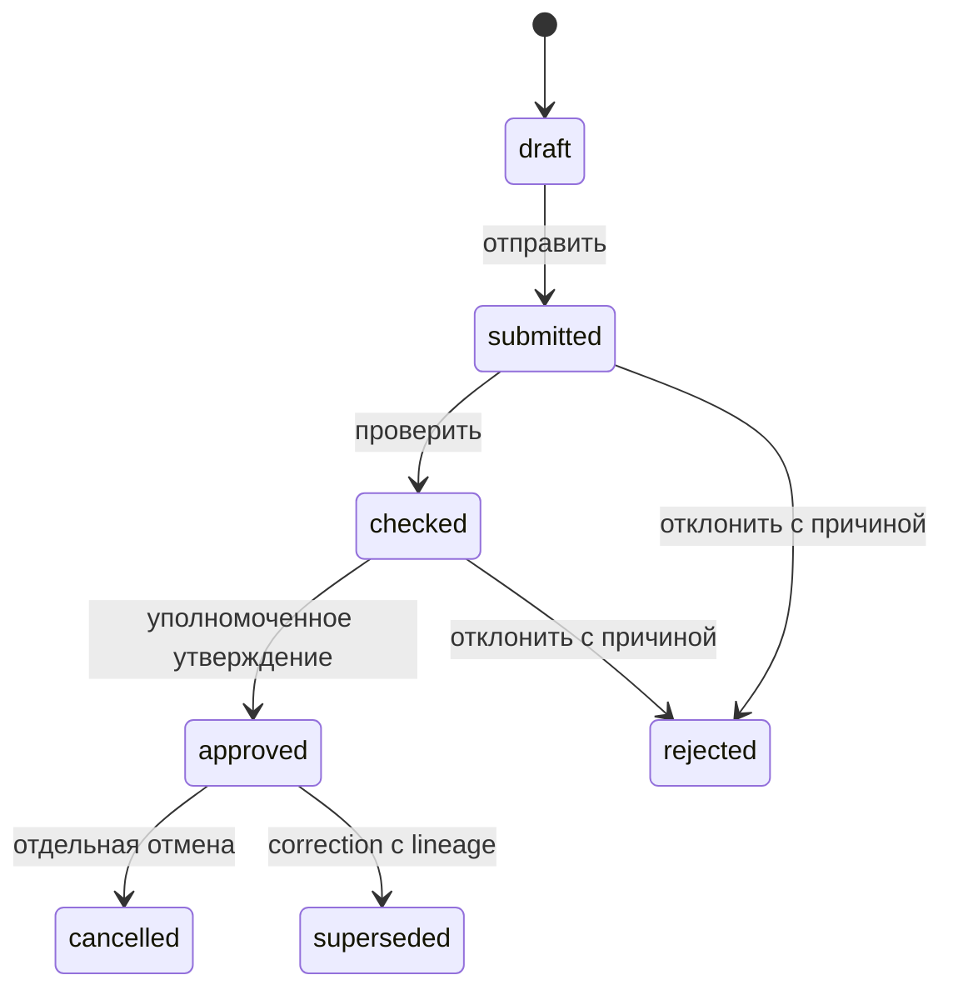

# PTO: независимые состояния и допустимые переходы

generated_at: 2026-10-26T06:19:09Z
git_commit: d7bf735359e8a54ef9e589c9a23cc28fc67876a9
db_migration_head: 20261106510000 / t2_agent_qidiruv_v1

Это карта существующих состояний и owner invariants, не новая миграция. Live SELECT constraint definitions26.10 подтвердил перечисления ниже. Наличие состояния не означает доступность каждого перехода каждому actor.

## F2 lifecycle и проекция

t2_akt.tur ∈ f2/fakt. holat ∈ qoralama/tasdiqlangan/bekor. lifecycle_status ∈ draft/submitted/checked/approved/rejected/cancelled/superseded. Не заводить третий статусный столбец. Авторитет перехода — существующие lifecycle RPC/guard/history triggers, не прямой UPDATE клиента. Источник: 20260920150000_t2_f2_lifecycle_v1.sql и live t2_akt_lifecycle_status_check.

Диаграмма — смысловая цепь; не добавляет разрешённые дуги в RPC. Реальные transition guards, history и capability проверяются перед командой. UI approve/cancel вызывает существующие akt_tasdiqlash/akt_bekor, gateway подставляет actor. Утверждённый акт заморожен; correction_of_akt_id и t2_akt_correction_link сохраняют связь. Пересчёт/экспорт читает допустимые approved источники, не все draft.

## Импорт — отдельный автомат

t2_f2_import_job.status ∈ queued/running/paused/review/completed/failed/cancelled; processed≥0, matched+unmatched≤processed≤total_rows, total_rows1…100000. Source_document_id/operation_id/lease_token/cursor/recovery_count — сохранённый процесс. Review импортера не означает approved акт; completed job не доказывает юридическое утверждение или правильность каждой связи. Возврат по tab восстанавливает job/akt только в том же company/object scope. Восстановление draft без исходного документа не должно притворяться успешным разбором.

## Изменение сметы — третий автомат

t2_smeta_ozgarish.holat ∈ qoralama/tasdiqlangan/rad/bekor. Типы: replacement/additional/removed/quantity/new section/item/resource replacement через существующие tur/kind. baseline_snapshot, natija_revision_id, evidence_hujjat_id, actor, version, operation_id связывают решение с версией. Текущий claude/smeta-versiya-farq расширяет этот автомат; отдельную таблицу версий/да'во из этого pack не создаём.

## Receipt операции — не business status

До первого await фиксируются company/object/date/точный body/chunks/UUID. Статусы попытки: planned → sending → confirmed / rejected / unknown. Это семантика очереди, не новый DB enum. Повтор unknown отправляет тот же ID и body либо сначала получает readback. Known confirmed нельзя отправить повторно с новой UUID. При partial: успешные receipts остаются; discard удаляет только отвергнутую часть; новый план ждёт свежий holatMap. Проверено на PR1437acb69f7 и PR144c5965290; PR143 уже входит в source pin d7bf7353, PR144 принимается отдельно.

## Ортогональное бизнес-решение

Экспертиза сократила смету, но работа построена → сохранить physical fact; связать revision diff, доказательство и решение «построено/не построено»; превышение entitlement вынести в review/claim/additional. «100%» не correction: JQA03 baseline120→100 остаётся запрещённым поведением до отдельного fix. Отмена работы/замена/дополнение не редактируют исходный документ и не удаляют уже утверждённый F2. Для необследованной работы значение остаётся неизвестным, не автоматически «выполнено» из факта наличия воды в водоёме.

## Граница публикации

Сначала preview изменений и предупреждений, затем явная команда со stable operation_id и expected version. Устаревшая версия → conflict/reload/review. Таймаут → unknown/readback. Новый company/object → изоляция незавершённого draft. Только подтверждённый результат даёт право UI показать успех; зеленые unit tests и snapshot_id не заменяют этот переход.
