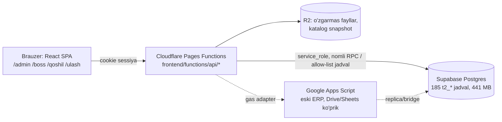

# E0 — Arxitektura auditi (2026-10-24, main `e1e0c0fd`, prod `tuoyrzadkgoltpqkdiyx`, faqat o'qish)

## Qatlamlar (amalda)

## Topilmalar

| # | Topilma | Ta'sir |
|---|---|---|
| A1 | 185 jadvalning hammasida RLS yoqilgan, ~6 tasida policy bor, qolganlarida yo'q → anon/authenticated uchun deny-all. Haqiqiy himoya: shlyuz (`_shared/tenant-oqish.ts` default-deny o'qish siyosati, `sb-yoz` yozuv reyestri, `permission-policy.ts`) + RPC ichidagi tekshiruv. | Pattern to'g'ri; har yangi jadval shunga amal qiladi (E2 §5). Brauzer→Supabase to'g'ridan (authenticated JWT) — **YO'Q**, egasi qarorisiz ochilmaydi. |
| A2 | Ruxsat modeli: `t2_azolik(foydalanuvchi, kompaniya, rol)` + `t2_permission_catalog_v2` (25 capability) + `t2_role_permissions_v2` + `t2_azolik_ruxsat_qoshimcha`; shlyuz `t2_men_v1` ni ≤60 s keshlaydi. `omborchi, mexanik, kadr, usta, haydovchi` rollari uchun ruxsat **bo'sh**. | Yangi rollar va capability lar kerak (E2 §3) — egasi tasdiqlashi kerak. |
| A3 | Kompaniyalararo poydevor **bor va prodda**: `t2_tomon_aloqa` (handshake, bir martalik kod xeshi), `t2_tomon_grant` (resurs×amal×obyekt/loyiha/shartnoma), `t2_tomon_taqdim` (o'zgarmas snapshot+xesh, qaror), `t2_tomon_murojaat` (remark/predpisaniya/RFI…), `t2_tomon_hodisa` (o'zgarmas jurnal), `t2_tomon_ruxsat_bor()`, `/api/tomon`, `t2_obyekt_ulash_v1` (havola orqali ulashish). | Ekotizimning yadrosi — **qayta ishlatiladi**, parallel tizim yozilmaydi. |
| A4 | Tomon rollari 3 joyda 3 xil yozilgan: `t2_loyiha_qatnashchi.rol` (`zakazchik, bosh_pudratchi, subpudratchi, loyihachi, taminotchi`), `t2_shartnoma_tomon.rol` (`Buyurtmachi, Pudratchi`), `t2_tomon_aloqa` (erkin matn: `pudratchi>mehmon`). | Yagona katalog `t2_yonalish` + taxallus xaritasi (E1 §3). |
| A5 | `t2_kontragent` — tenantning manzil kitobi, platformadagi `t2_kompaniya` ga bog'lanmagan. | `tomon_kompaniya_id` qo'shiladi (E1 §2). |
| A6 | Shaxs: `t2_foydalanuvchi` (login/email/google_sub) + `t2_kompaniya.turi='shaxsiy'` (shaxsiy ish joyi) + `t2_mutaxassis_profil` + `t2_ish_joyi_taklif` (kod bilan kompaniyaga qo'shilish) + `t2_xizmat_taklif`. | Usta/haydovchi/mustaqil inspektor uchun tayyor asos. |
| A7 | Hodisa: umumiy outbox/bildirishnoma YO'Q. Bor: `t2_tomon_hodisa`, `t2_signal` (23 768), `t2_audit_log`, `t2_contract_scope_event`, `t2_lrv_sync_event`. | `t2_outbox` + `t2_bildirishnoma` (E3 §6). |
| A8 | Kadr/texnika haqiqati hozir **GAS** da (`87_ErpModullar.js`, `gas('apiKadrlarDashboard')`); `api/t2-erp.ts` mavjud bo'lmagan `v_erp_*` view larni o'qiydi (o'lik kod). `t2_kadr_mustaqil`, `t2_texnika_mustaqil` jadvallari bor, bo'sh. | GAS→Supabase ko'chirish tamoyili (E3 §5.8). |
| A9 | Xarid: `t2_erp_taminot` = yagona zayavka haqiqati (PROCUREMENT_REQUEST_CONTRACT_V1). `t2_birja_rfq/_taklif` prodda migratsiyasiz sinov jadvallari (3 qator). Ombor: `t2_sklad_harakat` (kirim/chiqim, `m29_hujjat_id`), `t2_sklad_qoldiq`. | Order/yuk/reys jadvallari yo'q — E3 §4. |
| A10 | Pul: `t2_tolov`, `t2_xarajat` (kat ЧЕЛ/МАШ/МАТ/ОБ/SUB/OTK), `t2_faktura`, view `t2_bux_dashboard`, `t2_debitor_aging`. Kreditor qarzi, to'lov jadvali yo'q. | E3 §5.9. |
| A11 | Frontend: bitta `App.tsx` + `AdminShell.tsx` (umumiy issiq fayllar), `/admin/*` 60+ marshrut, `/admin/test/*` eski; PWA manifest bor, service worker yo'q; i18n `lugat/qism/<mavzu>.json`. | Marshrut modullari + `/m/*` (E4). |
| A12 | DB hajmi 441 MB (bepul reja chegarasi yaqin, ilgari VACUUM FULL uchun joy yetmagan). | GPS/foto/katta blob Postgres'ga yozilmaydi (E5). |
