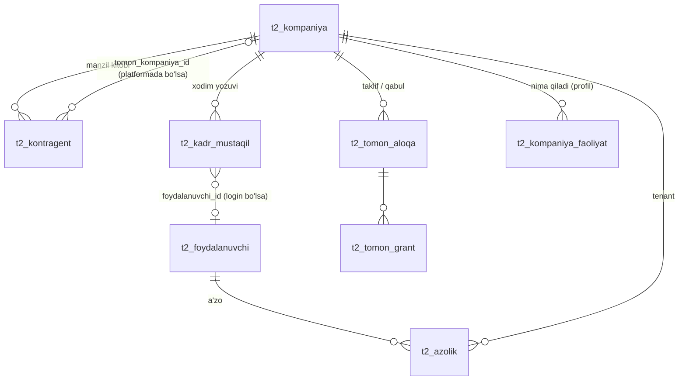
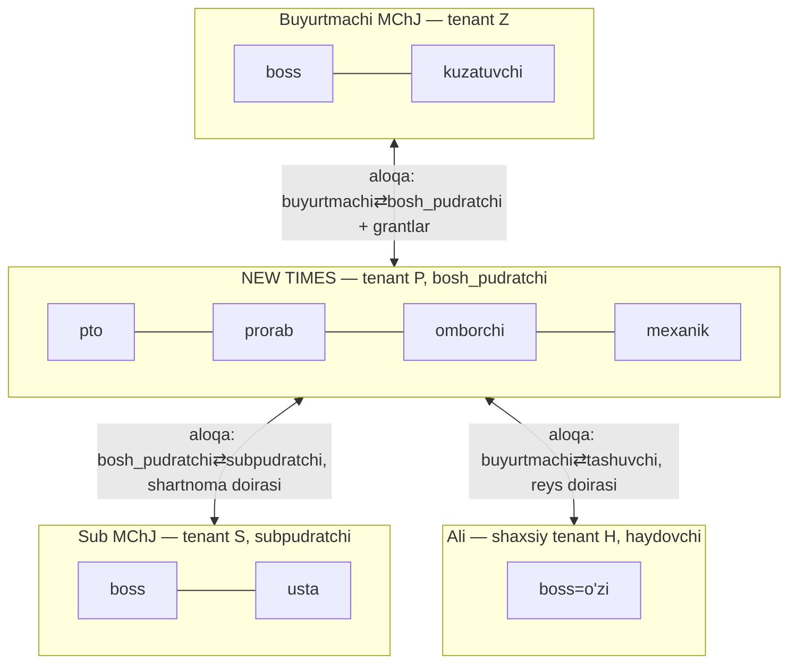

# E1 — Universal TOMON modeli

Holat: qabul qilingan v1 · 2026-10-24

## 1. Qaror: yangi «party» jadvali yaratilmaydi — 4 ta mavjud tushuncha aniq ajratiladi



| Tushuncha | Jadval | Kim | Qoida |
|---|---|---|---|
| **Tomon (platformada)** | `t2_kompaniya` | tashkilot (`turi='tashkilot'`) yoki shaxs (`turi='shaxsiy'`) | Tizimga kiradigan har tomon — kompaniya = tenant. Usta, haydovchi, mustaqil texnadzor — shaxsiy kompaniya (har foydalanuvchida bor, T1). |
| **Inson (login)** | `t2_foydalanuvchi` | bitta odam = bitta login | Bir odam N kompaniyada `t2_azolik` orqali, har birida o'z roli bilan. UI da faol kompaniya — `KompaniyaKontekst`. |
| **Kontragent (tenantning yozuvi)** | `t2_kontragent` | tenant ko'radigan tashqi tashkilot (rekvizit, INN) | Platformada bo'lmasa ham ishlaydi (oflayn tomon). Platformaga qo'shilsa — `tomon_kompaniya_id` bilan bog'lanadi (INN mos, ikki tomon tasdig'i — aloqa qabul qilinganda). |
| **Xodim (HR yozuvi)** | `t2_kadr_mustaqil` (kontseptual nom: xodim) | kompaniya ishchisi, login bo'lishi shart emas | Kontragent EMAS, a'zolik EMAS. Login bo'lsa `foydalanuvchi_id`. Shaxsiy maxfiy ma'lumot alohida jadvalda (E2 §3.3). |

**Javob (tomon-ichki savoli 1):** kontragent, xodim va usta uchun **bitta jadval emas**. Sabab: ular turli
egalik va hayot sikliga ega (kontragent — tashkilot rekviziti; xodim — HR/maosh; usta — login qiluvchi odam).
Ular ID orqali bog'lanadi: `kadr.foydalanuvchi_id`, `kontragent.tomon_kompaniya_id`.

## 2. Taklif etilgan qo'shimchalar (F1 migratsiyasi, arxitektura muallifi)

```sql
-- 1) Kontragent ↔ platforma tomoni
alter table t2_kontragent add column if not exists tomon_kompaniya_id bigint references t2_kompaniya(id);
-- faqat aloqa 'faol' bo'lganda va INN mos bo'lsa RPC orqali to'ldiriladi (t2_kontragent_tomon_bog_v1)

-- 2) Yagona tomon roli katalogi (erkin matn o'rniga)
create table if not exists t2_yonalish (
  kalit text primary key check (kalit ~ '^[a-z][a-z0-9_]{1,40}$'),
  nom text not null, nom_ru text not null, guruh text not null
    check (guruh in ('buyurtma','pudrat','loyiha','nazorat','taminot','logistika','moliya','boshqa')),
  qollanish text[] not null default '{shaxs,tashkilot,munosabat}',  -- E7: shaxs yo'nalishi / tashkilot faoliyati / munosabat roli
  eski_taxalluslar text[] not null default '{}', faol boolean not null default true, tartib int not null default 0);

-- 3) Kompaniya nima bilan shug'ullanadi (bozor/qidiruv uchun, ruxsat bermaydi)
create table if not exists t2_kompaniya_faoliyat (
  kompaniya_id bigint not null references t2_kompaniya(id), rol text not null references t2_yonalish(kalit),
  hudud text, izoh text, yaratildi timestamptz not null default now(), primary key (kompaniya_id, rol));

-- 4) Xodim ↔ login
alter table t2_kadr_mustaqil add column if not exists foydalanuvchi_id bigint references t2_foydalanuvchi(id);
```

## 3. Yo'nalish katalogi `t2_yonalish` (shaxs yo'nalishi, tashkilot faoliyati va munosabat roli uchun BITTA katalog — E7 §1)

Shaxs yo'nalishlari qo'shimcha: `usta`, `brigadir`, `pto`, `smetachi`, `prorab`, `omborchi`, `mexanik`, `operator`, `buxgalter`, `kadr`, `rahbar` (`qollanish={shaxs}`).

| kalit | guruh | eski taxalluslar |
|---|---|---|
| `buyurtmachi` | buyurtma | `zakazchik`, `Buyurtmachi` |
| `investor` | buyurtma | |
| `bosh_pudratchi` | pudrat | `pudratchi`, `Pudratchi` |
| `subpudratchi` | pudrat | |
| `brigada` | pudrat | (shaxsiy yoki kichik tashkilot brigadasi) |
| `loyihachi` | loyiha | |
| `ekspertiza` | loyiha | |
| `texnadzor` | nazorat | (buyurtmachi texnik nazorati) |
| `mualliflik_nazorati` | nazorat | |
| `inspeksiya` | nazorat | (davlat qurilish nazorati) |
| `laboratoriya` | nazorat | |
| `yetkazuvchi` | taminot | `taminotchi`, `ta'minotchi` |
| `texnika_ijarachi` | taminot | |
| `tashuvchi` | logistika | (transport kompaniyasi) |
| `haydovchi` | logistika | (shaxsiy tashuvchi) |
| `bank` | moliya | |
| `sugurta` | moliya | |
| `mehmon` | boshqa | (havola orqali ulashish, faqat ko'rish) |

Qoidalar: yangi rol = katalogga 1 qator (schema o'zgarmaydi). `t2_loyiha_qatnashchi` va `t2_shartnoma_tomon` dagi
mavjud yozuvlar **qayta yozilmaydi**; o'qishda `eski_taxalluslar` orqali xaritalanadi; yangi yozuv faqat katalog kaliti
bilan. `t2_tomon_aloqa.taklif_rol/qabul_rol` uchun yangi aloqalarda katalog kaliti majburiy (RPC tekshiradi).

## 4. Tomon roli (kompaniya munosabati) ≠ a'zo roli (odamning kompaniya ichidagi lavozimi)



- **A'zo roli** (`t2_azolik.rol`): `boss, rahbar, pto, prorab, bugalter, kuzatuvchi, buyurtmachi(eski), omborchi,
  mexanik, kadr, usta, haydovchi, inspektor, ta'minotchi` — capability to'plamini belgilaydi (E2 §3).
- **Tomon roli** (`t2_yonalish`): kompaniyalar orasidagi munosabat — qaysi grant shablonlari mantiqli ekanini belgilaydi.

## 5. Builderlar savollariga aniq javoblar

**Pudrat (subpudratchi / brigada / usta):**
- Platformadagi subpudratchi = **alohida `t2_kompaniya`** + bosh pudratchi bilan `t2_tomon_aloqa(turi='subpudrat')`
  + grantlar `shartnoma_id` doirasida. Bosh pudratchining `t2_kontragent` yozuvi `tomon_kompaniya_id` bilan bog'lanadi.
- Platformada YO'Q subpudratchi = faqat bosh pudratchining `t2_kontragent` yozuvi; uning ishini bosh pudratchi
  o'zi kiritadi (oflayn tomon). Keyin qo'shilsa — tarix ko'chirilmaydi, bog'lanadi.
- **Brigada** = ish beruvchi kompaniya ichidagi guruh: `t2_brigada(kompaniya_id, nom, brigadir_kadr_id, obyekt_id?)` +
  `t2_brigada_azo(brigada_id, kadr_id)` (tomon-pudrat egasi). Mustaqil brigada (o'z YaTT/MChJ) — alohida kompaniya,
  `brigada` tomon roli bilan.
- **Usta** = `t2_foydalanuvchi` (o'z shaxsiy ish joyi bor) → ish beruvchiga `t2_ish_joyi_taklif` kodi orqali qo'shiladi
  → `t2_azolik(rol='usta')` + `t2_obyekt_foydalanuvchi_ruxsat` (faqat biriktirilgan obyektlar) + brigada a'zoligi.
  «Faqat o'z doirasi»: kompaniya ichida = a'zolik + obyekt ruxsati (+ brigada); kompaniyalararo = grant + `shartnoma_id`.
- Usta kirishi: v1 — taklif havolasi/kod + mavjud login (parol yoki Google). **Telefon+SMS OTP — yangi auth kanali,
  egasi tasdig'i kerak** (pullik SMS provayder) → F4 ga.

**Nazorat:** inspektor har doim kompaniya kontekstida ishlaydi. Mustaqil texnadzor/inspektor shaxs — o'zining
shaxsiy kompaniyasi orqali (alohida «kompaniyasiz login» rejimi yo'q). Davlat inspeksiyasi/laboratoriya — tashkilot.
Aloqa `turi='nazorat'`, rollar `texnadzor|mualliflik_nazorati|inspeksiya|laboratoriya`.

**Ichki:** E1 §1 jadvali; HR maxfiy ma'lumot — E2 §3.3; GAS ko'chirish — E3 §5.8.
