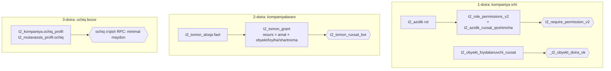

# E2 — Tenancy va kirish huquqi

Holat: qabul qilingan v1 · 2026-10-24. ⚠ bilan belgilangan bandlar — **egasi tasdig'i kerak** (auth/ruxsat keng o'zgarishi).

## 1. Uch doira



| Doira | Ma'lumot egasi | Kim ko'radi | Tekshiruv |
|---|---|---|---|
| L1 | tenant (`kompaniya_id`) | shu kompaniya a'zolari, capability bo'yicha; obyekt doirasi bilan toraytirilgan | shlyuz `requestPermission` + RPC `t2_require_permission_v2` + `_t2_obyekt_doira_ok` |
| L2 | baribir tenant (nusxa yo'q) | boshqa kompaniya — faqat faol aloqa + faol grant bo'yicha | `/api/tomon` yoki domen endpointi + RPC `t2_tomon_ruxsat_bor` |
| L3 | tenant ochiq deb belgilagan | hamma kirgan foydalanuvchi | alohida ochiq RPC, rekvizit/narx/shaxsiy ma'lumot yo'q |

## 2. Umumiy obyekt ish maydoni (shared obyekt workspace)

- Obyekt **bitta tenantga tegishli** (odatda bosh pudratchi yoki buyurtmachi). «Umumiy egalik» yo'q.
- Boshqa tomonlar obyektni grantlar orqali ko'radi; **o'z** ishini (o'z F2, o'z ombori, o'z tabeli) **o'z tenantida**
  yuritadi. Bog'lanish: `t2_obyekt_ulanish` (taklif) — `(kompaniya_id, ozining_obyekt_id, aloqa_id, tashqi_obyekt_id)`:
  subpudratchi o'z obyekt kartochkasini bosh pudratchi obyektiga xaritalaydi (FK emas — mantiqiy havola, aloqa faol
  bo'lsa ko'rinadi).
- Kompaniyalararo yozuv faqat 3 primitiv orqali: **taqdim** (hujjat/F2/AOSR/yuk topshirish → qaror), **murojaat**
  (remark/predpisaniya/RFI/yetkazish talabi), **hand-off buyrug'i** (E3 §4, masalan buyurtma → yuk). Boshqa
  tenant jadvaliga UPDATE yo'q.

## 3. Ruxsat modeli: rol → capability (obyekt/loyiha doirasida)

### 3.1 Capability katalogi kengaytmasi (⚠ egasi tasdig'i)
Mavjud 25 ta saqlanadi. Qo'shiladi (`domen.obyekt.amal` shaklida):

| Capability | Kim uchun |
|---|---|
| `procurement.read`, `procurement.write`, `procurement.approve` | xarid (zayavka, RFQ, buyurtma) |
| `supply.offer`, `supply.fulfil` | yetkazuvchi kompaniya a'zolari (taklif, buyurtma bajarish) |
| `logistics.read`, `logistics.dispatch`, `logistics.trip` | dispetcher; haydovchi (o'z reysi) |
| `warehouse.read`, `warehouse.write`, `warehouse.receive` | omborchi, prorab (qabul) |
| `quality.read`, `quality.inspect`, `quality.decide` | inspektor, texnadzor, lab |
| `design.read`, `design.write`, `design.issue` | loyihachi (chizma, revizya, ishga chiqarish) |
| `hr.read`, `hr.write`, `hr.pii.read`, `hr.pii.write`, `hr.tabel.write`, `payroll.read`, `payroll.write` | kadr, buxgalter, brigadir |
| `machinery.read`, `machinery.write`, `machinery.log` | mexanik, haydovchi/operator |
| `accounting.read`, `accounting.write`, `accounting.approve` | buxgalter (faktura, to'lov, qarz) — hozirgi `financial.*` bilan birga: eski kod `financial.*` ni ishlatadi, yangi kod `accounting.*`; `financial.*` = taxallus (bir xil rollarga beriladi) |
| `self.work.read`, `self.work.write` | usta/haydovchi — faqat o'ziga biriktirilgan vazifa, o'z tabeli, o'z daromadi |

### 3.2 Yangi a'zo rollari → capability (⚠ egasi tasdig'i; hozir bo'sh)
| Rol | Capability |
|---|---|
| `omborchi` | company.read, object.read, warehouse.*, procurement.read, logistics.read, fakt.read, document.read |
| `mexanik` | company.read, object.read, machinery.*, warehouse.read, document.read |
| `kadr` | company.read, object.read, hr.read, hr.write, hr.pii.read, hr.pii.write, hr.tabel.write, document.read |
| `bugalter` (mavjud + ) | + accounting.*, payroll.*, procurement.read, warehouse.read, hr.read |
| `ta'minotchi` (`taminotchi`) | company.read, object.read, procurement.*, logistics.read, logistics.dispatch, warehouse.read, document.read |
| `usta` | self.work.read, self.work.write, object.read (doira bilan), document.read (doira bilan), fakt.read |
| `brigadir` | usta + hr.tabel.write (o'z brigadasi), fakt.write (o'z obyekti) |
| `haydovchi` | self.work.read, self.work.write, logistics.trip, machinery.log |
| `inspektor` | object.read, document.read, quality.read, quality.inspect, quality.decide |
| `loyihachi` | object.read, document.read, document.write, design.* |

`boss/admin` — butun katalog (mavjud qoida). Yangi capability faqat `t2_permission_catalog_v2` + `t2_role_permissions_v2`
orqali; frontend/shlyuz ro'yxati qo'lda takrorlanmaydi (`t2_men_v1` qaytaradi).

### 3.3 HR shaxsiy ma'lumoti (javob: tomon-ichki savoli 2)
- `t2_kadr_mustaqil` — faqat ish ma'lumoti (ism, lavozim, razryad, brigada, holat, telefon ixtiyoriy).
- **`t2_kadr_maxfiy`** (1:1, `kadr_id` PK) — pasport, JSHSHIR, tug'ilgan sana, manzil, karta/hisob, maosh stavkasi.
  Faqat `hr.pii.read/write` (maosh — `payroll.read`). Ro'yxat RPC lari bu jadvalni JOIN qilmaydi. Har o'qish
  `t2_audit_log` ga (`amal_turi='pii_read'`). Kompaniyalararo grant resursi sifatida HECH QACHON taklif qilinmaydi.
- Usta o'z maxfiy yozuvini ko'ra oladi (`self.work.read`, `kadr.foydalanuvchi_id = actor`).

### 3.4 Obyekt doirasi (toraytirish)
Yordamchi (F1 da arxitektura yozadi):
```sql
-- true: actor shu kompaniyada shu obyektga kira oladi.
-- Qoida: rol 'usta','brigadir','haydovchi','inspektor' → FAQAT t2_obyekt_foydalanuvchi_ruxsat dagi obyektlar (default: hech narsa).
--        boshqa rollar → agar actor uchun shu kompaniyada kamida bitta faol qator bo'lsa, faqat o'shalar; bo'lmasa hammasi.
create function _t2_obyekt_doira_ok(p_actor_id bigint, p_kompaniya_id bigint, p_obyekt_id bigint) returns boolean ...
```

## 4. Taklif (invite) / kod oqimi — bitta mexanizm

| Holat | Mexanizm (mavjud) |
|---|---|
| Odamni o'z kompaniyamga qo'shish (usta, omborchi…) | `t2_ish_joyi_taklif` (kod xeshi, rol, muddat, max_soni) → `/qoshil/:kod` → `t2_azolik` |
| Boshqa kompaniyani munosabatga chaqirish | `t2_tomon_taklif_v1` (INN yoki bir martalik kod) → qabul → `t2_tomon_aloqa.holat='faol'` |
| Obyektni havola bilan ulashish | `t2_obyekt_ulash_v1` → `/ulash/:kod` → kutilgan grantlar faollashadi |
| Platformada yo'q tashkilotni chaqirish | kod bilan aloqa taklifi; qabul qiluvchi ro'yxatdan o'tib `t2_tomon_kod_qabul_v1` |

Qoidalar: bazada faqat SHA-256 xesh; ochiq kod javobda bir marta; muddat ≤7 kun; urinish limiti; har bosqich
`t2_tomon_hodisa` + `t2_outbox`. **Yangi invite jadvali yaratilmaydi.** Grant shablonlari: `t2_tomon_grant_shablon
(aloqa_turi, qabul_rol, resurs, amallar[])` — taklif yuborilayotganda `kutilgan_grantlar` ni to'ldirish uchun (F1).

## 5. RLS / RPC shabloni — har yangi jadval SHUNGA amal qiladi

```sql
-- ===== JADVAL =====
create table if not exists public.t2_<domen>_<narsa> (
  id            bigint generated always as identity primary key,
  kompaniya_id  bigint not null references public.t2_kompaniya(id),      -- egasi tenant
  obyekt_id     bigint references public.t2_obyekt(id),                  -- domen talab qilsa NOT NULL
  -- ... domen ustunlari (pul: numeric, NULL = noma'lum, 0 emas) ...
  holat         text not null default 'faol' check (holat in (...)),     -- hard delete yo'q
  versiya       integer not null default 1,
  operation_id  uuid not null,
  yaratdi_actor_id bigint not null references public.t2_foydalanuvchi(id),
  yaratildi     timestamptz not null default now(),
  yangilandi    timestamptz not null default now(),
  unique (kompaniya_id, operation_id)
);
create index if not exists t2_<..>_k_o_idx on public.t2_<..> (kompaniya_id, obyekt_id, id desc);
alter table public.t2_<..> enable row level security;            -- policy YO'Q = deny-all
revoke all on public.t2_<..> from anon, authenticated;
-- Ixtiyoriy: shlyuz /api/sb orqali o'qish kerak bo'lsa → _shared/tenant-oqish.ts OQISH_SIYOSATI ga { tur:'kompaniya' }.

-- ===== YOZUV RPC =====
create or replace function public.t2_<domen>_<amal>_v1(
  p_actor_id bigint, p_kompaniya_id bigint, p_operation_id uuid,
  p_kutilgan_versiya integer,          -- yangilashda majburiy; yaratishda null
  p_malumot jsonb)
returns jsonb language plpgsql security definer set search_path = public, pg_temp as $$
declare v_old jsonb; v_row public.t2_<..>;
begin
  perform public.t2_require_permission_v2(p_kompaniya_id, p_actor_id, '<domen>.write');
  if p_operation_id is null then return jsonb_build_object('ok',false,'code','OPERATION_ID_KERAK'); end if;
  -- idempotentlik: shu (kompaniya, operation_id) bor bo'lsa o'sha natijani qaytar
  select to_jsonb(t) into v_old from public.t2_<..> t where kompaniya_id=p_kompaniya_id and operation_id=p_operation_id;
  if v_old is not null then return jsonb_build_object('ok',true,'takror',true,'id',v_old->'id','versiya',v_old->'versiya'); end if;
  -- obyekt tenantga tegishli va actor doirasida
  if not public._t2_obyekt_doira_ok(p_actor_id, p_kompaniya_id, (p_malumot->>'obyekt_id')::bigint) then
    return jsonb_build_object('ok',false,'code','DOIRA_YOQ'); end if;
  -- yangilashda: update ... where id=? and kompaniya_id=p_kompaniya_id and versiya=p_kutilgan_versiya
  --             not found → {'ok':false,'code':'VERSIYA_ESKI'}
  insert into public.t2_<..>(...) values (...) returning * into v_row;
  perform public.t2_outbox_yoz(p_kompaniya_id, '<domen>.<narsa>.yaratildi', 't2_<..>', v_row.id,
                               jsonb_build_object('obyekt_id', v_row.obyekt_id), p_actor_id, p_operation_id);
  return jsonb_build_object('ok',true,'id',v_row.id,'versiya',v_row.versiya);
end $$;
revoke all on function public.t2_<domen>_<amal>_v1(bigint,bigint,uuid,integer,jsonb) from public, anon, authenticated;
grant execute on function public.t2_<domen>_<amal>_v1(bigint,bigint,uuid,integer,jsonb) to service_role;

-- ===== KOMPANIYALARARO O'QISH RPC =====
-- p_kompaniya_id = O'QUVCHI tenant; ma'lumot egasi = obyekt.kompaniya_id.
--   if o.kompaniya_id <> p_kompaniya_id and not t2_tomon_ruxsat_bor(p_kompaniya_id, o.kompaniya_id, '<resurs>', 'korish', o.id)
--   then return {'ok':false,'code':'RUXSAT_YOQ'}  -- mavjudligini ham oshkor qilmaydi
-- Yangi resurs → t2_tomon_resurs ga qator (faol=false), RPC + test tayyor bo'lganda faol=true (alohida migratsiya).
```

Shlyuz qoidasi: yangi endpoint `frontend/functions/api/<domen>.ts` — actor sessiyadan (`roleAuthority`), body dagi
`actor_id`/rolga ishonilmaydi, RPC nomi qat'iy ro'yxatdan (dinamik nom yo'q), `SCOPED_APIS` ga qo'shiladi,
`requestPermission` da capability. `/api/sb` va `/api/sb-yoz` ga kompaniyalararo narsa qo'shilmaydi.

## 6. Test shabloni (har migratsiya bilan majburiy)

`supabase/tests/t2_<domen>_<narsa>_contract.sql` — `t2_tomon_aloqa_contract.sql` uslubida: bitta `do $$ ... $$`,
TEST_ prefiksli fixture, natijalar `rep text[]`, oxirida `raise exception 'TEST_<DOMEN> %', array_to_string(rep, E'\n')`
(= rollback, hech narsa saqlanmaydi). Prodda ishga tushirilmaydi — disposable branch/lokal.

Majburiy holatlar (minimal 10):
1. Ruxsatli rol yaratadi → `ok`.  2. Ruxsatsiz rol (kuzatuvchi) → `PERMISSION_DENIED`.
3. Begona kompaniya actori → rad.  4. Begona tenant obyekti → rad.
5. Bir xil `operation_id` takrori → bitta qator, `takror=true`.  6. Eski `kutilgan_versiya` → `VERSIYA_ESKI`.
7. Obyekt doirasidan tashqari usta → `DOIRA_YOQ`.  8. Kompaniyalararo: grantsiz → `RUXSAT_YOQ`; grant bilan → ko'radi;
   aloqa yopilgach → yana `RUXSAT_YOQ`.  9. `anon`/`authenticated` RPC ni chaqira olmaydi (`has_function_privilege`).
10. Outbox qatori yozilgan (bitta, to'g'ri `mavzu`).  + NULL ≠ 0 holati pul maydonida bo'lsa.

## 7. Egasi tasdig'i kerak bo'lgan bandlar (⚠)
1. Capability katalogi kengaytmasi va yangi rollar xaritasi (§3.1–3.2).
2. `_t2_obyekt_doira_ok` ni mavjud RPC larga tatbiq etish (prorab/pto uchun ko'rinish torayishi mumkin — hozir
   `t2_obyekt_foydalanuvchi_ruxsat` bo'sh, shuning uchun amalda o'zgarmaydi).
3. Telefon/SMS OTP orqali kirish (yangi auth kanal + pullik provayder).
4. Brauzer/mobil → Supabase to'g'ridan (authenticated JWT + haqiqiy RLS policy) — **tavsiya etilmaydi**; shlyuz qoladi.
5. `/api/tomon` dan tashqari kompaniyalararo endpointlar (masalan `/api/yuk`) — har biri `t2_tomon_ruxsat_bor` bilan.
