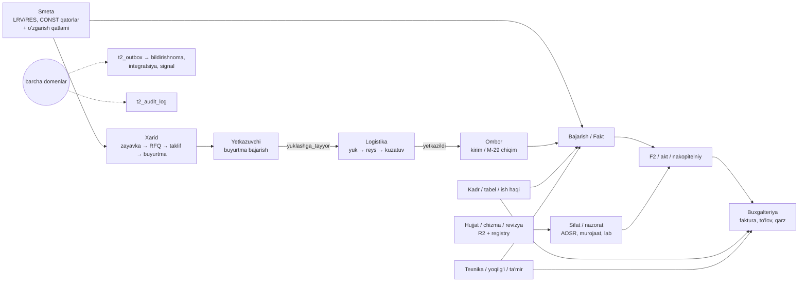
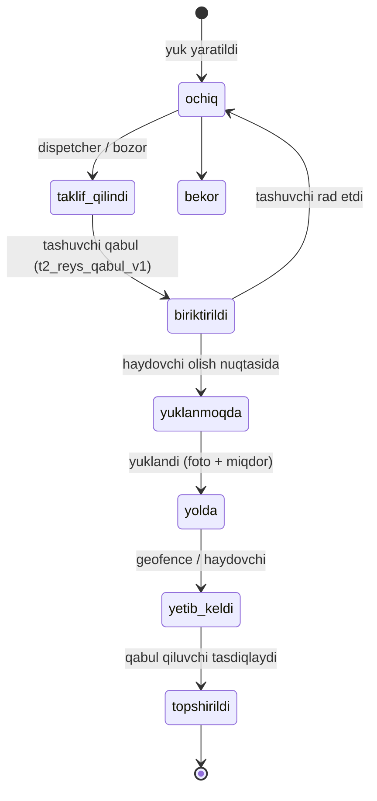

# E3 — Domen chegaralari, umumiy ID lar va hand-off kontraktlari

Holat: qabul qilingan v1 · 2026-10-24

## 1. Domenlar xaritasi



## 2. Umumiy ID lar (shared keys) — hamma domen faqat shularga tayanadi

| ID | Manba | Izoh |
|---|---|---|
| `kompaniya_id` | `t2_kompaniya` | tenant; har qatorda egasi |
| `foydalanuvchi_id` / `actor_id` | `t2_foydalanuvchi` | yozuvchi odam (sessiyadan) |
| `loyiha_id`, `obyekt_id` | `t2_loyiha`, `t2_obyekt` | obyekt — asosiy ish birligi; `t2_tuzilma.id` — bino/seksiya/qavat (ixtiyoriy) |
| `shartnoma_id` | `t2_shartnoma` (+ `t2_shartnoma_tomon`) | kompaniyalararo doira kaliti |
| `aloqa_id` | `t2_tomon_aloqa` | kompaniyalararo munosabat |
| `qator_id` | `t2_qator` (smeta, CONST) | ish/resurs qatori; o'zgarmaydi |
| `resurs_kodi` (shifr) | R2 katalog (o'zgarmas) + `t2_material_alias` | material/mehnat/mashina identifikatori; `material_id` (nullable) — material master paydo bo'lguncha |
| `akt_id` | `t2_akt` | F2/fakt hujjati |
| `hujjat_id` | `t2_document_registry` | har fayl (R2 key, sha256, revision) |
| `kadr_id`, `texnika_id` | `t2_kadr_mustaqil`, `t2_texnika_mustaqil` | HR / texnika yozuvi |
| `operation_id` | mijoz yaratadi (uuid) | idempotentlik, retry da o'zgarmaydi |

Qoida: domen boshqa domen ID siga **FK** qo'yishi mumkin (o'qish bog'i), lekin boshqa domen jadvaliga **yozmaydi**.
Universal edge jadvali yo'q (Konstitutsiya).

## 3. Domen egaligi (jadval → egasi builder)

| Domen | Jadvallar (mavjud / *yangi*) | Egasi |
|---|---|---|
| Tomon yadrosi, ruxsat, outbox | `t2_tomon_*`, `t2_azolik*`, `t2_permission*`, *`t2_yonalish`*, *`t2_kompaniya_faoliyat`*, *`t2_tomon_grant_shablon`*, *`t2_outbox`*, *`t2_bildirishnoma`* | **arxitektura** (F1) |
| Smeta, F2, fakt, nakopitelniy | `t2_qator`, `t2_smeta_*`, `t2_akt*`, `t2_f2_*` | mavjud smeta/F2 agentlari (ekotizim builderlari TEGMAYDI, faqat o'qiydi) |
| Buyurtmachi kabineti | *`t2_izoh`* (qator darajasidagi izoh), buyurtmachi read-model RPC lari | tomon-buyurtmachi |
| Loyihachi / chizma | *`t2_chizma_toplam`*, *`t2_chizma_revizya`* (fayl — `t2_document_registry`) | tomon-loyihachi |
| Sifat / nazorat | `t2_aosr*`, `t2_lab_protokol*`, `t2_tomon_murojaat` turlari, *`t2_tekshiruv`* (inspeksiya tashrifi) | tomon-nazorat |
| Xarid + yetkazuvchi (+ P2 tender, P3 buyurtma yadrosi — E7) | `t2_erp_taminot` (zayavka, yagona), `t2_birja_rfq`/`t2_birja_taklif` (baseline migratsiya bilan qabul qilinadi), *`t2_buyurtma`*, *`t2_buyurtma_qator`* | tomon-yetkazuvchi |
| Logistika | *`t2_transport`*, *`t2_yuk`*, *`t2_yuk_qator`*, *`t2_reys`*, *`t2_reys_nuqta`*, *`t2_reys_hodisa`* | tomon-logistika |
| Pudrat / brigada / usta | *`t2_brigada`*, *`t2_brigada_azo`*, P1 *`t2_topshiriq`* (yadro, E7) + *`t2_vazifa_tafsilot`* (qator_id, hajm, birlik), *`t2_obyekt_ulanish`* | tomon-pudrat |
| Ombor | `t2_sklad_harakat`, `t2_sklad_qoldiq`, `t2_m29_hujjat` | tomon-ichki (kirim RPC si logistika hand-off ini qabul qiladi) |
| Kadr / tabel / ish haqi | `t2_kadr_mustaqil`, *`t2_kadr_maxfiy`*, *`t2_tabel`*, *`t2_ish_haqi_hisob`* | tomon-ichki |
| Texnika | `t2_texnika_mustaqil`, *`t2_texnika_jurnal`* (moto-soat, yoqilg'i), *`t2_texnika_tamir`* | tomon-ichki |
| Buxgalteriya | `t2_faktura`, `t2_tolov`, `t2_xarajat`, *`t2_tolov_jadval`*, view *`t2_kreditor_qarz`* | tomon-ichki |

## 4. Hand-off kontraktlari (domenlar orasidagi yagona eshiklar)

Har hand-off = **egasi domenning nomli RPC si** + bitta tranzaksiyada `t2_outbox` hodisasi. Chaqiruvchi domen boshqa
domen jadvaliga INSERT qilmaydi.

### 4.1 Smeta → Xarid (zayavka)
`t2_zayavka_yarat_v1(p_actor_id, p_kompaniya_id, p_operation_id, p_obyekt_id, p_qatorlar jsonb)` — mavjud
`t2_erp_taminot` ga yozadi (PROCUREMENT_REQUEST_CONTRACT_V1). Qator: `{item_text, resurs_kodi?, qator_id?, requested_qty,
unit, required_date, priority, note}`. Smeta qatori CONST — zayavka unga faqat havola qiladi. Hodisa: `zayavka.yaratildi`.

### 4.2 Xarid → Yetkazuvchi (RFQ → taklif → buyurtma)
> **Kanonik imzolar — E7 §3.2** (`t2_tender_*`, `t2_buyurtma_*`). Quyidagi `t2_rfq_*` / `t2_buyurtma_holat_v1` — ma'no tavsifi; amalda E7 nomlari ishlatiladi.
- `t2_rfq_yarat_v1(actor, kompaniya, op, p_zayavka_idlar bigint[], p_qabul_qiluvchilar bigint[] /*kompaniya*/, p_muddat)`.
  Yetkazuvchi RFQ ni grant resursi `rfq` (`korish`,`taklif`) orqali ko'radi; ochiq RFQ (L3 bozor) — `ochiq=true`.
- `t2_rfq_taklif_ber_v1(actor, yetkazuvchi_kompaniya, op, p_rfq_id, p_qatorlar jsonb /*narx NDS siz, qqs alohida*/)`.
- `t2_buyurtma_yarat_v1(actor, xaridor_kompaniya, op, p_taklif_id | p_qatorlar, p_yetkazish jsonb)` — `t2_buyurtma`
  **xaridor tenantida**; yetkazuvchi grant `buyurtma` (`korish`,`bajarish`) bilan ko'radi.
- Holatlar: `qoralama → yuborildi → qabul_qilindi | rad → tayyorlanmoqda → yuklashga_tayyor → yolda → yetkazildi →
  qabul_qilindi_omborda | qisman | bekor`. Yetkazuvchi tomon o'zgartiradigan holatlar faqat
  `t2_buyurtma_holat_v1(actor, yetkazuvchi_kompaniya, op, p_buyurtma_id, p_kutilgan_versiya, p_holat, p_izoh)` orqali
  (RPC ichida `t2_tomon_ruxsat_bor(..., 'buyurtma','bajarish', obyekt_id)`).

### 4.3 Yetkazuvchi → Logistika (yuklashga_tayyor) — asosiy hand-off
`yuklashga_tayyor` holatiga o'tishda `t2_buyurtma_holat_v1` **logistika RPC sini chaqiradi**:

```text
t2_yuk_yarat_v1(
  p_actor_id bigint, p_kompaniya_id bigint /* yukni boshqaradigan tenant = tolovchi tomon */,
  p_operation_id uuid,
  p_manba jsonb  -- {"tur":"buyurtma","buyurtma_id":..,"xaridor_kompaniya_id":..,"yetkazuvchi_kompaniya_id":..}
  p_olish jsonb  -- {"manzil":"..","lat":..,"lng":..,"aloqa_tel":"..","oyna_dan":"ts","oyna_gacha":"ts"}
  p_yetkazish jsonb -- {"obyekt_id":..,"manzil":"..","lat":..,"lng":..,"qabul_qiluvchi_actor_id":..,"oyna_dan":"ts","oyna_gacha":"ts"}
  p_qatorlar jsonb -- [{"buyurtma_qator_id":..,"nom":"..","birlik":"..","miqdor":..,"vazn_kg":..|null,"hajm_m3":..|null}]
  p_talab jsonb   -- {"transport_turi":"samosval|bortli|..|null","tolovchi":"yetkazuvchi|xaridor"}
) returns jsonb   -- {ok, yuk_id, versiya}
```
- `t2_yuk` egasi: `tolovchi` tomonining tenanti; ikkinchi tomon grant `yuk` (`korish`) bilan kuzatadi.
- NULL ≠ 0: vazn/hajm noma'lum bo'lsa NULL; koordinata noma'lum bo'lsa NULL (soxta koordinata yo'q).
- Idempotent: `(kompaniya_id, operation_id)`; bitta buyurtma uchun faol yuk — unique `(manba buyurtma_id) where holat<>'bekor'`.
- Hodisa: `buyurtma.yuklashga_tayyor`, `yuk.yaratildi`.

### 4.4 Logistika ichida (Yandex/Uber modeli)

- `t2_reys(yuk_id, tashuvchi_kompaniya_id, haydovchi_foydalanuvchi_id, transport_id, narx NDS siz, holat, versiya)`.
  Tashuvchi (tashkilot yoki shaxsiy haydovchi kompaniyasi) reysni grant `reys` orqali ko'radi.
- `t2_reys_nuqta(reys_id, vaqt, lat, lng, aniqlik_m, tezlik)` — append-only, partition/oylik tozalash (E5).
- RPC lar: `t2_reys_taklif_v1`, `t2_reys_qabul_v1`, `t2_reys_holat_v1`, `t2_reys_nuqta_yoz_v1(p_nuqtalar jsonb /*≤200*/)`.

### 4.5 Logistika → Ombor (topshirildi → kirim)
`t2_ombor_kirim_yuk_v1(p_actor_id, p_kompaniya_id /*xaridor*/, p_operation_id, p_yuk_id, p_qatorlar jsonb
/*[{buyurtma_qator_id, qabul_miqdor, holat:'butun|shikast|kam'}]*/, p_hujjat_idlar bigint[] /*foto, TTN*/)` —
**tomon-ichki** egasi; `t2_sklad_harakat(operatsiya='kirim', manba='yuk', ...)` yozadi, `t2_erp_taminot.delivered_qty`
ni yangilaydi, buyurtmani `qabul_qilindi_omborda|qisman` ga o'tkazadi (yetkazuvchi RPC si orqali). Hodisa:
`ombor.kirim`, `buyurtma.qabul_qilindi`. Keyin buxgalteriya kutilgan kreditor qarzini ko'radi.

### 4.6 Ombor → Fakt (M-29)
Mavjud M-29 oqimi (ADR-3: M-29 orqali ombor chiqimi, `fakt.write`). Ekotizim builderlari o'zgartirmaydi.

### 4.7 Pudrat: usta → fakt → F2 → buyurtmachi
- Ustaga ish = P1 `t2_topshiriq(tur='ish')` + `t2_vazifa_tafsilot(topshiriq_id, qator_id?, brigada_id?, hajm, birlik)` —
  prorab ustaga topshiriq beradi. Usta `t2_topshiriq_otish_v1(holat='bajarildi', dalil)` (hajm + foto) → prorab tasdiqlasa mavjud fakt RPC si
  chaqiriladi (fakt yozish egasi — mavjud fakt domeni). Usta to'g'ridan fakt yozmaydi.
- Subpudratchi → bosh pudratchi F2: mavjud `t2_tomon_taqdim_yarat_v1(resurs='f2')` → qaror. Qabul qilingan sub F2 bosh
  pudratchi xarajatiga `t2_xarajat(kat='SUB', manba='taqdim', hujjat_ref=taqdim_id)` sifatida — tomon-ichki RPC
  `t2_xarajat_taqdimdan_v1`. Avtomatik emas: buxgalter tasdiqlaydi.
- Bosh pudratchi → buyurtmachi: mavjud taqdim F2 + qaror.

### 4.8 Hujjat / chizma (loyihachi) — javob: savol 4
Fayl haqiqati — `t2_document_registry` (R2). Yangi fayl ombori YO'Q. Ustiga metadata qatlami:
`t2_chizma_toplam(kompaniya_id, obyekt_id, marka /*АР,КЖ,ОВ..*/, kod, nom, holat)` +
`t2_chizma_revizya(toplam_id, revizya_raqami, hujjat_id → t2_document_registry, holat:
'loyiha|ishga_ruxsat|bekor', sabab, chiqardi_actor_id)`. Ishga chiqarish = loyihachi tenantida `design.issue` +
`t2_tomon_taqdim(resurs='chizma')` → pudratchi qabul qiladi. Bitta toplamda bitta `ishga_ruxsat` revizya (partial unique).

### 4.9 Sifat (nazorat) — javob: savol 2
AOSR/lab/murojaat mavjud. `aosr`, `remark` resurslarini faollashtirish tartibi: (1) builder kompaniyalararo o'qish RPC si
+ qaror RPC si `t2_tomon_ruxsat_bor` bilan; (2) contract test (E2 §6); (3) arxitektura ko'rigi; (4) bitta migratsiya
`update t2_tomon_resurs set faol=true where kalit in (...)`. Inspeksiya tashrifi: `t2_tekshiruv(kompaniya_id /*inspektor
tenanti*/, aloqa_id, obyekt_id, sana, natija, hujjat_idlar)` + topilmalar → `t2_tomon_murojaat(turi='predpisaniya')`.

### 4.10 Buyurtmachi — javob: savol 3
- To'lov ko'rinishi: buyurtmachi pudratchining `t2_tolov` (`tur=kirim`, shu `shartnoma_id`) ni grant `tolov_holati`
  orqali ko'radi (read RPC — tomon-buyurtmachi yozadi, jadval egasi tomon-ichki). Buyurtmachining **o'z** to'lovlari o'z
  tenantidagi `t2_tolov(tur=chiqim)`. To'lov jadvali `t2_tolov_jadval(kompaniya_id, shartnoma_id, sana, summa, izoh)` —
  tomon-ichki egasi, har tenant o'zinikini yuritadi; taqqoslash read-model da.
- Qator darajasidagi izoh: `t2_izoh(kompaniya_id /*yozuvchi*/, aloqa_id, manba_jadval /*allow-list: t2_akt_qator,
  t2_qator, t2_chizma_revizya, t2_aosr*/, manba_id, matn, holat, ...)` — tomon-buyurtmachi egasi, boshqa tomonlar ham
  ishlatadi. Rasmiy talab/remark kerak bo'lsa — `t2_tomon_murojaat`.
- In-app bildirishnoma — `t2_outbox` → `t2_bildirishnoma` (pastda §6). `t2_tomon_hodisa` jurnal bo'lib qoladi;
  `_t2_tomon_hodisa_yoz` F1 da outbox ga ham yozadigan qilib kengaytiriladi.

### 4.11 Kadr / tabel / ish haqi / usta daromadi
- `t2_tabel(kompaniya_id, kadr_id, obyekt_id, sana, soat, ish_turi?, brigada_id?, manba 'usta|brigadir|kadr', holat
  'kiritildi|tasdiqlandi', versiya, operation_id)`, unique `(kadr_id, obyekt_id, sana)` faol.
- `t2_ish_haqi_hisob(kompaniya_id, kadr_id, davr, hisoblangan, ushlangan, tolangan, holat)` — `payroll.*`.
- `t2_usta_daromad_v1(p_actor_id, p_kompaniya_id, p_davr)` — tomon-ichki yozadi; actor = `kadr.foydalanuvchi_id`
  bo'lgan yozuvlar bo'yicha o'z tabeli/hisobini qaytaradi; tomon-pudrat mobil yuzasi chaqiradi.

### 4.12 Texnika
`t2_texnika_jurnal(kompaniya_id, texnika_id, obyekt_id, sana, moto_soat, yoqilgi_l, operator_kadr_id, manba)` —
mexanik/haydovchi kiritadi (`machinery.log`); mash-soat smeta katalogi bilan taqqoslash read-model da. Ta'mir —
`t2_texnika_tamir`. Yoqilg'i ombordan chiqsa — ombor RPC si orqali.

## 5. Qo'shimcha qoidalar

5.1 Pul: barcha summalar NDS siz, ustamali+ustamasiz ko'rinishi `SummaJuft`/`useUstamaliSumma` orqali; QQS alohida.
5.2 Rasmiy hujjatlar (F2, M-29, TTN, AOSR) rus tilida; UI 4 tilda.
5.3 Status matnlari — `check (holat in (...))`, kalitlar lotin kichik harf.
5.4 Kompaniyalararo snapshot — faqat `t2_tomon_taqdim` (xesh bilan); boshqa jadvalga nusxa yo'q.
5.5 AI faqat taklif beradi; miqdor/narx/koordinata o'ylab topilmaydi.
5.6 Har domen o'z read-model RPC sini beradi; boshqa domen UI si jadvalni `/api/sb` orqali to'g'ridan o'qimaydi.
5.7 Birja jadvallari: tomon-yetkazuvchi prod tuzilishiga mos `create table if not exists` baseline migratsiyasi yozadi,
    keyin additiv ustunlar. Yangi parallel RFQ jadvali YO'Q.
5.8 **GAS → Supabase ko'chirish tamoyili (kadr/texnika):** (1) Supabase jadvali + RPC + test avval; (2) bir martalik
    import — idempotent (`manba='gas_import'`, tabiiy kalit: kompaniya+ism+lavozim / davlat raqami), `kompaniya_id` va
    `obyekt_id` majburiy, xaritalab bo'lmaganlar hisobotga (yo'qotilmaydi, taxmin qilinmaydi); (3) UI `/api/*` ga
    o'tadi; (4) GAS faqat o'qiladigan replica yoki o'chiriladi (egasi qarori); (5) `api/t2-erp.ts` dagi o'lik `v_erp_*`
    o'qishlari olib tashlanadi. Import prodga — parent orqali.

## 6. Hodisa shinasi (outbox) va bildirishnoma — F1, arxitektura

```sql
create table if not exists public.t2_outbox (
  id bigint generated always as identity primary key,
  kompaniya_id bigint not null references public.t2_kompaniya(id),   -- hodisani chiqargan tenant
  mavzu text not null check (mavzu ~ '^[a-z_]+\.[a-z_]+(\.[a-z_]+)?$'),  -- 'buyurtma.yuklashga_tayyor'
  entity_jadval text not null, entity_id bigint not null,
  obyekt_id bigint, aloqa_id bigint,                                   -- marshrutlash uchun
  qabul_kompaniya_idlar bigint[] not null default '{}',                -- kompaniyalararo bo'lsa
  payload jsonb not null default '{}' check (pg_column_size(payload) <= 4096),  -- kichik; katta narsa = havola
  actor_id bigint, operation_id uuid,
  yaratildi timestamptz not null default now(),
  unique (kompaniya_id, mavzu, operation_id));
create index if not exists t2_outbox_yaratildi_idx on public.t2_outbox (yaratildi);   -- tozalash uchun
create index if not exists t2_outbox_obyekt_idx on public.t2_outbox (obyekt_id, id desc) where obyekt_id is not null;

create table if not exists public.t2_outbox_kursor (iste_molchi text primary key, oxirgi_id bigint not null default 0,
  yangilandi timestamptz not null default now());

create table if not exists public.t2_bildirishnoma (
  id bigint generated always as identity primary key,
  foydalanuvchi_id bigint not null, kompaniya_id bigint not null, outbox_id bigint not null,
  sarlavha_kalit text not null, parametrlar jsonb not null default '{}', havola text,
  oqildi timestamptz, yaratildi timestamptz not null default now(),
  unique (foydalanuvchi_id, outbox_id));

-- Domen RPC lari ichida (bitta tranzaksiya):
--   perform t2_outbox_yoz(p_kompaniya_id, 'yuk.yaratildi', 't2_yuk', v_id, p_payload, p_actor_id, p_operation_id,
--                         p_obyekt_id => .., p_qabul => array[..]);
```
- Iste'molchilar: `bildirishnoma` (rol/obyekt/grant bo'yicha qabul qiluvchilarni aniqlaydi), keyin `telegram`,
  `didox`, `signal`. Kursor bilan, at-least-once; iste'molchi idempotent (`unique(foydalanuvchi_id, outbox_id)`).
- Ishga tushirish: Cloudflare Cron Trigger → `/api/outbox-ishlov` (service) har 1 daqiqa, partiya ≤500 (E5).
- Saqlash: 90 kun, keyin tozalash (audit uchun `t2_audit_log` bor).
- Mavzu nomlari: `<domen>.<hodisa>` — ro'yxat shu hujjatda yuritiladi (yangi mavzu = PR da shu jadvalga qator):

| Mavzu | Chiqaruvchi |
|---|---|
| `zayavka.yaratildi`, `zayavka.tasdiqlandi` | xarid |
| `rfq.yuborildi`, `rfq.taklif_keldi`, `buyurtma.yuborildi`, `buyurtma.holat`, `buyurtma.yuklashga_tayyor` | yetkazuvchi |
| `yuk.yaratildi`, `reys.biriktirildi`, `reys.holat`, `reys.topshirildi` | logistika |
| `ombor.kirim`, `ombor.chiqim` | ichki |
| `taqdim.yuborildi`, `taqdim.qaror`, `murojaat.ochildi`, `murojaat.javob`, `aloqa.taklif`, `aloqa.faol` | tomon yadrosi |
| `chizma.ishga_chiqarildi` | loyihachi |
| `tekshiruv.yakunlandi`, `aosr.qaror` | nazorat |
| `topshiriq.berildi`, `topshiriq.qabul_qilindi`, `topshiriq.bajarildi`, `topshiriq.tasdiqlandi` | P1 yadro (pudrat) |
| `tender.elon`, `tender.taklif`, `tender.golib` | P2 yadro (yetkazuvchi) |
| `izoh.yozildi`, `kontakt.taklif`, `kontakt.faol`, `baho.berildi` | P4 / arxitektura |
| `tabel.tasdiqlandi`, `ish_haqi.hisoblandi`, `tolov.qilindi` | ichki |

## 7. Audit
Har yozuv RPC: `t2_audit_yoz(...)` (mavjud) yoki domen trigger. PII o'qish, ruxsat berish/olish, grant, kod qabul,
hard holat o'zgarishlari — majburiy audit. Audit va `t2_tomon_hodisa` — o'zgarmas.
