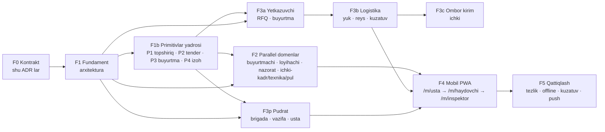

# E6 — Bosqichli yo'l xaritasi va builder qoidalari

Holat: qabul qilingan v1 · 2026-10-24

## 1. Bosqichlar (bog'liqlik tartibida)

| Bosqich | Nima | Kim | Kirish sharti | Chiqish dalili |
|---|---|---|---|---|
| **F0** | ADR E0–E6 | arxitektura | — | docs PR merge |
| **F1** | `t2_yonalish` (+seed), `t2_kompaniya_faoliyat`, `t2_kontragent.tomon_kompaniya_id`, `t2_kadr_mustaqil.foydalanuvchi_id`, `t2_tomon_grant_shablon`, `t2_outbox`+`_kursor`+`t2_outbox_yoz()`, `t2_bildirishnoma`, `_t2_obyekt_doira_ok()`, `t2_obyekt.manzil/geozona_radius_m/chegara_geojson/geokod_manba` (E3 §4.4.3), capability/rol kengaytmasi ⚠, `_t2_tomon_hodisa_yoz` → outbox , + E7: `t2_shaxs_yonalish`, `t2_katalog_qidir_v1`, kontakt (`aloqa turi='kontakt'`), `t2_primitiv_tur`, `t2_bosqich_katalog`, `t2_primitiv_dalil`, `t2_baho` | arxitektura yozadi → parent qo'llaydi | egasi ⚠ tasdig'i (capability/rol) | contract testlar yashil; `t2_men_v1` yangi capability larni qaytaradi |
| **F1b** | Primitivlar yadrosi (E7 §3), domen-agnostik: P1 `t2_topshiriq` (tomon-pudrat), P2 tender (`t2_birja_*` baseline+kengaytma) + P3 `t2_buyurtma` (tomon-yetkazuvchi), P4 `t2_izoh` (tomon-buyurtmachi) | 3 builder parallel, arxitektura ko'rigi | F1 (outbox, katalog) — imzolar E7 §3.2 bo'yicha F1 bilan parallel boshlanishi mumkin | E2 §6 testlari + kompaniyalararo ikki tomon testi |
| **Smeta snapshot** | E7 §4: `t2_smeta_revision.snapshot_*`, R2 gzip JSON, `/api/smeta-snapshot`, klient xesh-kesh | smeta/F2 agentlari (ekotizimdan tashqari) | — (mustaqil, darhol) | F2 import obyekt smetasi ≤3 s issiq / ≤10 s sovuq |
| **F2** | Buyurtmachi kabineti (to'lov holati, izoh, bildirishnoma ko'rinishi); loyihachi chizma/revizya; nazorat (aosr/remark resurslarini faollashtirish, tekshiruv); ichki: kadr+maxfiy, tabel, texnika jurnal, to'lov jadvali, kreditor qarzi, GAS→Supabase importi | 4 builder parallel | F1 | har domen: migratsiya+rollback+contract test+shlyuz test+UI test |
| **F3a** | birja baseline, RFQ, taklif, `t2_buyurtma` | tomon-yetkazuvchi | F1 | `buyurtma.yuklashga_tayyor` outbox hodisasi chiqadi |
| **F3b** | `t2_transport`, `t2_yuk`, `t2_reys`, `t2_reys_nuqta`, dispetcher `/admin/yuk`, tashuvchi kabineti | tomon-logistika | F3a RPC imzosi (§4.3) — mock bilan oldinroq boshlash mumkin | `t2_yuk_yarat_v1` contract test |
| **F3c** | `t2_ombor_kirim_yuk_v1` | tomon-ichki | F3b | kirim → delivered_qty → buyurtma holati |
| **F3p** | `t2_brigada`, `t2_vazifa_tafsilot` (P1 ustida), `t2_obyekt_ulanish`, sub F2 → `t2_xarajat_taqdimdan_v1` (ichki bilan) | tomon-pudrat | F1 | vazifa → hisobot → fakt (mavjud RPC) |
| **F4** | `MobilShell` + SW + offline navbat (pudrat birinchi), keyin `/m/haydovchi` (logistika), `/m/inspektor` (nazorat), `/m/ombor`, `/m/mexanik` (ichki) | pudrat → boshqalar | F3p/F3b | Lighthouse mobil, offline replay testi |
| **F5** | budjet testlari, Web Push, SMS OTP ⚠, trek siqish | arxitektura + builderlar | F4 | E5 byudjetlari yashil |

## 2. Migratsiya raqam oraliqlari (to'qnashuvsiz)

| Egasi | Prefiks oralig'i |
|---|---|
| arxitektura (F1) | `202611080000xx` – `202611080999xx` |
| tomon-buyurtmachi | `20261108100000` – `20261108199999` |
| tomon-loyihachi | `20261108200000` – `20261108299999` |
| tomon-nazorat | `20261108300000` – `20261108399999` |
| tomon-yetkazuvchi | `20261108400000` – `20261108499999` |
| tomon-logistika | `20261108500000` – `20261108599999` |
| tomon-pudrat | `20261108600000` – `20261108699999` |
| tomon-ichki | `20261108700000` – `20261108799999` |

Har migratsiya: `<ts>_t2_<domen>_<nom>_v1.sql` + `.rollback.sql` + `supabase/tests/t2_<domen>_<nom>_contract.sql`.

## 3. Builder qoidalari (har biri majburiy)

1. Faqat E3 §3 dagi **o'z jadvallaringiz**ga yozasiz; boshqa domenga — uning nomli RPC si orqali. Kerakli RPC yo'q bo'lsa —
   imzoni arxitekturaga taklif qilasiz, mock bilan ishlab turasiz.
2. Har jadval/RPC — E2 §5 shabloni: `kompaniya_id NOT NULL`, RLS on + policy yo'q + revoke, SECURITY DEFINER, `service_role`
   grant, actor/tenant/capability tekshiruvi, `operation_id`, `versiya`, `holat` (hard delete yo'q), outbox.
3. Kompaniyalararo o'qish — faqat `t2_tomon_ruxsat_bor`; yangi resurs `t2_tomon_resurs` ga `faol=false` bilan, test + ko'rikdan
   keyin yoqiladi.
4. Tomon roli — `t2_yonalish` katalogidan; a'zo roli/capability — E2 §3; o'zingiz yangi rol nomini o'ylab topmang.
5. Yangi invite/kod jadvali, yangi fayl ombori, yangi hodisa jadvali, yangi «party» jadvali YARATILMAYDI.
6. Prod migratsiya — hech qachon o'zingiz emas: PR → arxitektura ko'rigi → parent qo'llaydi.
7. Shlyuz: `functions/api/<domen>.ts`, RPC nomlari qat'iy ro'yxat, actor sessiyadan, `SCOPED_APIS`+`requestPermission`.
8. UI: marshrut `admin/<domen>/marshrutlar.tsx`, `App.tsx`/`AdminShell.tsx` ga bitta qator; i18n `lugat/qism/<domen>.json`;
   summalar `SummaJuft`; `t()` har matnda.
9. Pul NDS siz; NULL ≠ 0; soxta koordinata/narx/miqdor yo'q; AI faqat taklif.
10. Har PR tavsifida: owned paths, migratsiya ro'yxati, test natijasi, DB o'sish bahosi, ochiq savollar.

## 4. Ko'rik tartibi
Builder migratsiya/dizayn taklifini parent orqali arxitekturaga yuboradi. Arxitektura tekshiradi: (a) egalik (E3 §3),
(b) RLS/RPC shabloni (E2 §5), (c) contract test 10 holati (E2 §6), (d) hand-off imzolari (E3 §4), (e) hajm (E5 §4),
(f) ⚠ bandlar. Natija: `QABUL` / `TUZATISH: <ro'yxat>`.
