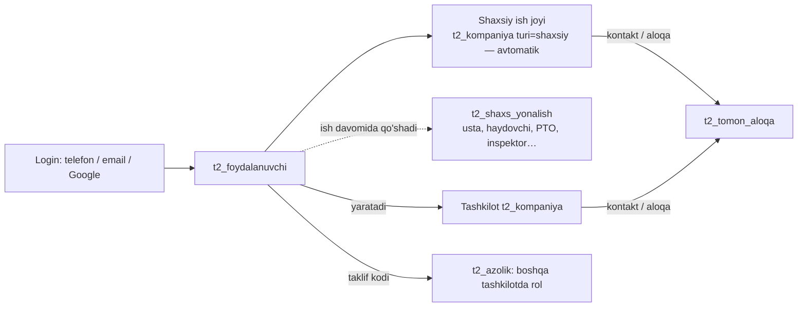

# E7 — Shaxs-birinchi, katalog (qidiruv) va umumiy ish primitivlari

Holat: qabul qilingan v1 · 2026-10-24 · **egasining asosiy tamoyili** (o'z so'zi):
«Telegram arxitekturasidek: xohlagan odam login qilib kirib, keyingi ishlarini ish davomida belgilab, yo'nalishiga
tushib borishi kerak. Hamma o'ziga kerak joyda kerakli ma'lumotni olishi kerak; kerakli shaxslarni topib, boshqarib,
buyurib, buyruqni qabul qilib, tender qilib yutib yoki mahsulotini chiqarib… O'zimizning ish (PTO/F2) davom etsin…
Ortiqcha yuklama bo'lmasin, tez, ideal, xatosiz ishlashi kerak.»

## 1. Shaxs-birinchi (identity-first)



- Bitta odam = bitta akkaunt (`t2_foydalanuvchi`). Ro'yxatdan o'tishda **rol so'ralmaydi**; shaxsiy ish joyi avtomatik.
- **Yo'nalish** (kasb/faoliyat) — profilga ish davomida qo'shiladi: `t2_shaxs_yonalish(foydalanuvchi_id, yonalish →
  t2_yonalish, hudud, tajriba_yil, ochiq bool, tasdiqlangan bool, yaratildi)`. Mavjud `t2_mutaxassis_profil` (bio,
  ochiqlik) saqlanadi; `kasb` matni yo'nalish qatorlariga ko'chiriladi (additiv).
- Tashkilot yo'nalishi — `t2_kompaniya_faoliyat` (E1). Bitta katalog `t2_yonalish` shaxs, tashkilot va munosabat
  roli uchun umumiy (`qollanish text[]`: `shaxs`, `tashkilot`, `munosabat`).
- **Yo'nalish ruxsat bermaydi.** U faqat: (a) qidiruvda topilish, (b) UI da qaysi yuzalar taklif qilinishi
  («yo'nalishiga tushib borish»: haydovchi yo'nalishi → `/m/haydovchi` kartasi ko'rinadi), (c) tender/buyurtma
  takliflarini moslash. Ruxsat — faqat `t2_azolik` roli (E2 §3) yoki grant/primitiv tomonligi.
- Telefon raqami bilan kirish (SMS OTP) — ⚠ egasi tasdig'i (pullik provayder). Shu vaqtgacha telefon profil maydoni
  (`t2_foydalanuvchi.telefon`, tasdiqlanmagan), login — email/parol/Google.

## 2. Katalog (directory) va kontaktlar

- `t2_katalog_qidir_v1(p_actor_id, p_yonalish text, p_hudud text, p_matn text, p_tur 'shaxs'|'tashkilot'|null,
  p_limit int ≤50, p_keyin text)` → faqat `ochiq` profillar: ism/nom, yo'nalishlar, hudud, reyting, bajarilgan ishlar
  soni (agar `statistika_korsat`). **Telefon, email, INN dan tashqari rekvizit, narx, shaxsiy ma'lumot — qaytarilmaydi.**
- Maxfiylik sozlamasi: `t2_mutaxassis_profil.ochiq`, `t2_kompaniya.ochiq_profil`, yo'nalish darajasida `ochiq`.
  Default — yopiq.
- **Kontakt (Telegram kontaktidek)** = `t2_tomon_aloqa(turi='kontakt')` — shaxsiy yoki tashkilot ish joylari orasida,
  handshake bilan (mavjud `t2_tomon_taklif_v1/javob_v1`). Kontakt grant bermaydi; faqat bir-biriga primitiv yuborish
  (topshiriq, buyurtma, tender taklifi, murojaat) va aloqa ma'lumotini ko'rishga imkon beradi.
- Spamga qarshi: kuniga taklif limiti (mavjud uslub, 50/kun), rad etilgan kontaktga 30 kun qayta taklif yo'q.
- **Reyting:** `t2_baho(baholovchi_kompaniya_id, baholovchi_actor_id, baholangan_kompaniya_id, baholangan_foydalanuvchi_id?,
  manba_jadval ∈ {t2_topshiriq,t2_buyurtma,t2_birja_rfq}, manba_id, ball 1..5, izoh, yaratildi)`, unique
  `(baholovchi_kompaniya_id, manba_jadval, manba_id)`. Faqat **yakunlangan** primitivdan keyin; agregat profil
  read-modelida. Soxta reyting yo'q (NULL = baho yo'q).

## 3. Umumiy ish primitivlari — har modul SHULARNI ishlatadi, o'z velosipedini yasamaydi

| Primitiv | Jadval | Hayot sikli | Kim ishlatadi |
|---|---|---|---|
| **P1 Topshiriq / buyruq** | `t2_topshiriq` (yangi) | `berildi → qabul_qilindi \| rad → bajarilmoqda → bajarildi (dalil) → tasdiqlandi \| qaytarildi`; `bekor` | prorab→usta (ish), dispetcher→haydovchi (reys), mexanik (ta'mir), texnadzor→pudratchi (predpisaniyani bajarish), boss→xodim |
| **P2 Tender / RFQ** | `t2_birja_rfq` + `t2_birja_rfq_qator` + `t2_birja_taklif` (mavjud 2 jadval baseline + kengaytma) | `qoralama → elon → yopildi → golib_tanlandi \| bekor`; taklif: `berildi → golib \| yutqazdi \| qaytarib_olindi` | material, xizmat, subpudrat, transport (Uber modeli: yuk e'loni → tashuvchilar taklifi), texnika ijarasi, loyihalash, laboratoriya |
| **P3 Buyurtma** (mahsulot/xizmat) | `t2_buyurtma` + `t2_buyurtma_qator` (yangi) | `yuborildi → qabul_qilindi \| rad → bajarilmoqda → tayyor → topshirildi → qabul_qilindi_yakuniy \| qisman \| nizo`; `bekor`. Turga xos ichki bosqich — `bosqich` (katalogdan, masalan material: `yuklashga_tayyor`, `yolda`) | yetkazuvchi, tashuvchi, texnika ijarasi, subpudrat xizmati, laboratoriya sinovi |
| **P4 Murojaat / xabar** | `t2_tomon_murojaat` (mavjud) + `t2_izoh` (yangi, yengil izoh ipi) | mavjud: `ochiq → bajarildi → yopildi \| qayta_ochildi`; izoh — ip | remark, predpisaniya, RFI, savol, yetkazish talabi, qator izohi |
| **P5 Taqdim / qaror** | `t2_tomon_taqdim` (mavjud) | `yuborildi → ko_rilmoqda → qabul \| rad \| tuzatish` | F2, AOSR, chizma revizyasi, hujjat |

### 3.1 Umumiy qoidalar (barcha primitivlar)
- **Yozuv tomonlari:** `kompaniya_id` (beruvchi = egasi tenant) + `ijrochi_kompaniya_id` (+ ixtiyoriy
  `ijrochi_foydalanuvchi_id`). Ikki tomon ham yozuvni ko'radi; kompaniyalararo bo'lsa faol `aloqa_id` (kontakt yoki
  shartnoma aloqasi) majburiy. Uchinchi tomon — faqat grant orqali (obyekt doirasi). Bu `t2_tomon_murojaat` dagi
  isbotlangan pattern.
- **Domen tafsiloti — 1:1 jadval** primitivga FK bilan: `t2_reys.topshiriq_id`, `t2_yuk.buyurtma_id`,
  `t2_vazifa_tafsilot.topshiriq_id (qator_id, hajm, birlik)`. Primitiv jadvaliga domenga xos ustun qo'shilmaydi
  (`manba_jadval/manba_id` + kichik `meta jsonb ≤2 KB` yetadi).
- **Holat o'tishi faqat RPC da**, har o'tish: ruxsat (qaysi tomon), `p_kutilgan_versiya`, `operation_id`,
  `t2_outbox` (`<primitiv>.<holat>`), audit. Turga xos bosqichlar — `t2_bosqich_katalog(primitiv, tur, kalit, nom, nom_ru,
  tartib, kim 'beruvchi'|'ijrochi')` — yangi bosqich = 1 qator.
- `tur` — katalog (`t2_primitiv_tur(primitiv, kalit, nom, nom_ru, faol)`): masalan topshiriq: `ish, reys, tamir,
  tekshiruv, tuzatish, boshqa`; buyurtma/tender: `material, xizmat, subpudrat, transport, texnika_ijara, loyihalash,
  laboratoriya`.
- Dalil (foto, TTN, protokol) — `hujjat_id` lar (R2), primitivga `t2_primitiv_dalil(primitiv, primitiv_id, hujjat_id)`.
- Pul: NDS siz, QQS alohida; NULL = noma'lum.
- Zanjir: tender g'olibi → `t2_buyurtma_yarat_v1(p_taklif_id)`; buyurtma(material) `yuklashga_tayyor` →
  `t2_yuk_yarat_v1` (E3 §4.3) → tashuvchi tanlash: tender(transport) yoki to'g'ridan buyurtma(transport) →
  reys = topshiriq(reys) haydovchiga + `t2_reys` tafsiloti; topshirildi → ombor kirim.

### 3.2 Primitiv RPC imzolari (minimal, barchasi `jsonb {ok, code?, id?, versiya?}` qaytaradi)
```text
t2_topshiriq_ber_v1(p_actor_id, p_kompaniya_id, p_operation_id, p_tur, p_ijrochi_kompaniya_id, p_ijrochi_foydalanuvchi_id,
                    p_aloqa_id, p_obyekt_id, p_sarlavha, p_matn, p_muddat, p_manba jsonb, p_meta jsonb)
t2_topshiriq_otish_v1(p_actor_id, p_kompaniya_id /*actor tenanti*/, p_operation_id, p_topshiriq_id, p_kutilgan_versiya,
                      p_holat, p_izoh, p_dalil_hujjat_idlar bigint[])
t2_topshiriqlar_v1(p_actor_id, p_kompaniya_id, p_yonalish 'menga'|'mendan', p_holat, p_obyekt_id, p_limit, p_keyin_id)

t2_tender_elon_v1(p_actor_id, p_kompaniya_id, p_operation_id, p_tur, p_doira 'ochiq'|'taklif', p_qabul_kompaniya_idlar bigint[],
                  p_obyekt_id, p_muddat, p_qatorlar jsonb, p_shart jsonb)
t2_tender_taklif_ber_v1(p_actor_id, p_kompaniya_id /*taklif beruvchi*/, p_operation_id, p_rfq_id, p_qatorlar jsonb, p_izoh)
t2_tender_golib_v1(p_actor_id, p_kompaniya_id, p_operation_id, p_rfq_id, p_kutilgan_versiya, p_taklif_id) -- buyurtma yaratadi
t2_tenderlar_v1(p_actor_id, p_kompaniya_id, p_yonalish 'meniki'|'menga'|'ochiq', p_tur, p_limit, p_keyin_id)

t2_buyurtma_yarat_v1(p_actor_id, p_kompaniya_id, p_operation_id, p_tur, p_ijrochi_kompaniya_id, p_aloqa_id, p_taklif_id,
                     p_obyekt_id, p_qatorlar jsonb, p_shart jsonb)
t2_buyurtma_otish_v1(p_actor_id, p_kompaniya_id, p_operation_id, p_buyurtma_id, p_kutilgan_versiya, p_holat, p_bosqich,
                     p_izoh, p_dalil_hujjat_idlar bigint[])
t2_buyurtmalar_v1(p_actor_id, p_kompaniya_id, p_yonalish 'meniki'|'menga', p_tur, p_holat, p_limit, p_keyin_id)

t2_izoh_yoz_v1(p_actor_id, p_kompaniya_id, p_operation_id, p_aloqa_id, p_manba_jadval, p_manba_id, p_matn, p_ota_izoh_id)
t2_baho_ber_v1(p_actor_id, p_kompaniya_id, p_operation_id, p_manba_jadval, p_manba_id, p_ball, p_izoh)
```
(E3 §4.2 dagi `t2_rfq_*`/`t2_buyurtma_holat_v1` nomlari shu imzolar bilan almashtiriladi — kanonik nomlar shular.)

### 3.3 Primitivlarni kim quradi (domen-agnostik yadro, arxitektura ko'rigi bilan)
| Primitiv | Quruvchi | Iste'molchilar |
|---|---|---|
| `t2_yonalish`, `t2_shaxs_yonalish`, katalog qidiruvi, kontakt, `t2_outbox`, `t2_bildirishnoma`, `t2_primitiv_tur`, `t2_bosqich_katalog`, `t2_primitiv_dalil`, `t2_baho` | arxitektura (F1) | hammasi |
| P1 `t2_topshiriq` | tomon-pudrat | logistika (reys), ichki (ta'mir, xodim), nazorat (tuzatish) |
| P2 tender + P3 buyurtma | tomon-yetkazuvchi | logistika (transport), pudrat (subpudrat), loyihachi, nazorat (laboratoriya), ichki (texnika ijarasi) |
| P4 `t2_izoh` | tomon-buyurtmachi | hammasi |

Quruvchi primitivga domenga xos narsa qo'shmaydi; boshqa builder ehtiyoji — katalog qatori yoki 1:1 tafsilot jadvali.

## 4. Ma'lumot joylashuvi va o'zgarmas smeta snapshot

- **Supabase** = o'zgaruvchan biznes/shaxs/kompaniya holati, kichik qatorlar.
- **R2** = o'zgarmas yoki katta: smeta revizya snapshotlari, kataloglar, fayllar, hujjat arxivlari, reys treklari —
  **versiyalangan kalit** bilan.
- **Qoida «o'zgarmas smeta snapshot»** (muammo: F2 import obyekt smetasini — `t2_daraxt` ~25k qator — har ochishda
  6 bo'lakda ketma-ket o'qiydi, ~32 s):
  1. Smeta revizyasi muzlaganda (`t2_smeta_revision` yaratilganda/tasdiqlanganda) server ishi daraxtni bitta
     **gzip JSON** ga yozadi: R2 kalit `smeta-snapshot/<kompaniya_id>/<obyekt_id>/<revision_id>-<sha256_16>.json.gz`.
  2. `t2_smeta_revision` ga additiv ustunlar: `snapshot_r2_key`, `snapshot_sha256`, `snapshot_qator_soni`,
     `snapshot_bayt`, `snapshot_holat ('yoq'|'tayyor'|'xato')`. Kalit o'zgarmaydi; yangi revizya = yangi kalit.
  3. Klient avval kichik RPC dan joriy `revision_id + sha256` ni oladi; IndexedDB/Cache API da shu xesh bo'lsa —
     tarmoqsiz; bo'lmasa shlyuz endpointi `GET /api/smeta-snapshot?obyekt_id&revision_id` (tenant/ruxsat tekshiruvi,
     `ETag = sha256`, `Cache-Control: private, max-age=31536000, immutable`) — **bitta so'rov**.
  4. O'zgaruvchan qatlam (fakt, holat, F2 bog'lanishlari, o'zgarish qatlami) alohida, kichik, sahifalangan RPC bilan
     ustiga qo'yiladi. Asl qatorlar CONST qoidasi bilan mos: snapshot — aynan asl qatorlar.
  5. Snapshot tayyor bo'lmasa (`snapshot_holat<>'tayyor'`) — eski yo'l (Supabase bo'laklari) zaxira sifatida.
  6. Maqsad: F2 import/smeta ochish ≤ 3 s issiq keshda, ≤ 10 s sovuq.
  Egalik: smeta/F2 agentlari (ekotizim builderlari emas); arxitektura kontrakt beradi. Shu pattern boshqa katta
  o'zgarmas o'qishlarga ham (yopilgan F2 aktlari, katalog relizlari) qo'llanadi.

## 5. Sifat byudjeti (qisqa; batafsil E5)
Sahifa ≤2 s; og'ir ish oynasi ≤10 s; mobil — past tarmoqda ham ishlaydi (offline navbat, `operation_id` idempotent);
har yangi RPC/jadval: indeks, keyset sahifalash, RLS/contract test.
